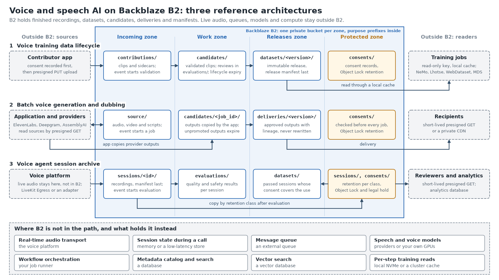

# B2 reference architectures for voice and speech AI

Reference architectures for storing, versioning and delivering voice and speech AI data on Backblaze B2: training datasets, generated audio and voice agent session recordings. Each architecture comes with a data flow, an object layout, security and retention rules, the B2 configuration it needs as templates, and the places where B2 does not belong in the design. Current B2 product behavior is documented at [backblaze.com/docs](https://www.backblaze.com/docs/cloud-storage).



B2 is the durable layer around an existing voice application: finished recordings, dataset releases, generation candidates and approved deliveries, manifests and evaluation results. Live audio, session state, queues, models and orchestration stay in the systems built for them.

## Quick start

No B2 account is needed to run the tests or read the provisioning plan.

```bash
git clone https://github.com/backblaze-b2-samples/b2-voice-ai-reference-architectures.git
cd b2-voice-ai-reference-architectures
python3 -m venv .venv && . .venv/bin/activate
pip install -r requirements-catalog.txt -r requirements-dev.txt

# Tests for the catalog tooling, schemas, fixtures, templates, examples and helpers
python -m pytest -q tests
python tools/validate_contracts.py

# Print (do not run) the b2 commands that create one architecture's buckets and keys
python infrastructure/b2-provisioning/provision.py --bucket-prefix my-org --architecture voice-agent-session-archive
```

Then pick the architecture that matches your workflow below and read its `architecture.md`. To create the buckets for real, follow [B2 bucket and key provisioning](infrastructure/b2-provisioning/README.md) and then the [configuration templates](examples/README.md). The TypeScript examples run with `bash tools/run_ts_examples.sh` (Node.js 22).

## Architectures

<!-- catalog:architectures:start -->
| Architecture | Purpose | Resources |
|---|---|---|
| [Voice training data lifecycle](architectures/voice-training-data-lifecycle/architecture.md) | Collect speech with consent, validate and review it, and publish immutable dataset releases that NeMo, Lhotse, Hugging Face Datasets, WebDataset and MosaicML Streaming read from B2. | [application](applications/voice-dataset-ingest/README.md) / [deployment](infrastructure/b2-provisioning/README.md) |
| [Batch voice generation and dubbing](architectures/batch-voice-generation-and-dubbing/architecture.md) | Send sources to dubbing, speech synthesis and transcription providers through presigned GET URLs, keep every output as an expiring candidate, and promote reviewed outputs to immutable deliveries with lineage. | [application](applications/voice-generation-artifacts/README.md) / [deployment](infrastructure/b2-provisioning/README.md) |
| [Voice agent session archive](architectures/voice-agent-session-archive/architecture.md) | Archive finished voice agent sessions from LiveKit Egress or a session adapter, evaluate each session for quality and safety, retain it per class under Object Lock, and select only passed, consented sessions for review, analytics or datasets. | [deployment](infrastructure/livekit-egress/README.md) |
<!-- catalog:architectures:end -->

Each architecture folder holds `architecture.md` (data flow, boundaries, where B2 does not fit, security, evidence, known limitations), `decisions.md` and `object-layout.md`. The folder name is the catalog id.

## What is in this repository

| Path | Contents |
|---|---|
| [`architectures/`](architectures/) | One folder per architecture, named by its catalog id |
| [`catalog/architectures.yaml`](catalog/architectures.yaml) | Machine-readable catalog: audiences, workflows, boundaries, capabilities, integrations, evidence and links |
| [`docs/b2-capabilities.md`](docs/b2-capabilities.md) | B2 capability map: what each capability does, what it requires, its limitations and which architecture uses it |
| [`docs/architecture-index.md`](docs/architecture-index.md) | Index of the architectures, generated from the catalog |
| [`docs/voice-speech-ai.md`](docs/voice-speech-ai.md) | Category page: what the architectures cover, where B2 fits and does not, standard B2 versus Overdrive, when to use, when not to use, FAQ |
| [`docs/related-b2-samples.md`](docs/related-b2-samples.md) | Existing public sample applications for audio, speech and transcription on B2, each with the date its B2 integration checks passed |
| [`applications/`](applications/README.md) | Sample applications that implement the architectures, and how each entry is described |
| [`examples/`](examples/README.md) | B2 configuration templates (CORS, lifecycle, Event Notifications, Object Lock, replication, encryption), scoped key commands, and Python and TypeScript code examples |
| [`infrastructure/`](infrastructure/README.md) | LiveKit Egress output to B2, and provisioning of per-zone buckets and scoped keys |
| [`schemas/`](schemas/) and [`manifests/`](manifests/) | JSON Schemas for session, generation job, consent, dataset line, release and delivery manifests, with valid examples |
| [`testdata/synthetic-speech/`](testdata/synthetic-speech/README.md) | Synthetic speech fixtures, including deliberately invalid clips; no recording of a real person |
| [`skill/`](skill/SKILL.md) | The `b2-voice-speech-ai` agent skill and its references; `skill/references/architecture-catalog.md` is generated from the catalog |
| [`metadata/`](metadata/README.md) | Where the repository's citation and discovery metadata lives |
| [`tools/`](tools/) | Catalog generator, validators, link check, fixture builder and diagram renderer |
| [`tests/`](tests/) | Tests that run without a B2 account |
| [`AGENTS.md`](AGENTS.md) and [`llms.txt`](llms.txt) | Guidance for AI coding agents and an index for language models |

## B2 capabilities used

The [capability map](docs/b2-capabilities.md) has one row per capability, with requirements, limitations and links to the Backblaze documentation. In short:

- **S3-compatible API**, with the endpoint derived from the bucket's region, so existing SDKs and tools work unchanged.
- **Presigned URLs and CORS** for browser uploads, review playback and provider downloads without sharing a key.
- **Multipart upload** with retry, resume, complete and abort for long recordings and shards.
- **Application keys limited to one bucket and prefix**, one per component.
- **Event Notifications** with a signed webhook, processed once per `eventId`.
- **Versions and lifecycle rules** to expire raw uploads, candidates and scratch data per zone.
- **Server-side encryption** (SSE-B2 as the bucket default).
- **Object Lock** retention and legal hold for consent records and retained sessions.
- **Cloud Replication** of releases to a second region.
- **Delivery** through short-lived presigned URLs, a private CDN, or compute partners reading through the S3-compatible API.
- **Standard B2 and B2 Overdrive**: standard B2 holds every zone; Overdrive applies only when sustained aggregate read throughput is the measured constraint. Training reads go through a local cache either way.

Prices and egress allowances are not copied into this repository; see the [B2 pricing page](https://www.backblaze.com/cloud-storage/pricing).

## Where state lives

In the architectures:

| State | Where it lives |
|---|---|
| Raw uploads, session recordings and generation sources | Incoming zone bucket (`contributions/`, `sessions/`, `source/`), expired by lifecycle after processing |
| Candidates, scratch data and evaluation results | Work zone bucket (`candidates/`, `scratch/`, `evaluations/`) |
| Dataset releases and approved deliveries | Releases zone bucket (`datasets/`, `deliveries/`), one immutable prefix per version with its manifest written last |
| Consent records and retained sessions | Protected zone bucket (`consents/`, `sessions/`), with Object Lock |
| Job queue, processed `eventId` values, review state, search indexes | Outside B2: a queue and a database chosen by the application |
| Live audio and in-call agent state | Outside B2: the voice platform and the agent's memory or low-latency store |
| Training working set | Outside B2: local NVMe or a cluster cache, refilled from a release |

There is one bucket per zone because lifecycle, Object Lock, replication, encryption defaults and notification rules are set per bucket, and an application key admits a single prefix. The bucket names come from `B2_INCOMING_BUCKET`, `B2_WORK_BUCKET`, `B2_RELEASES_BUCKET` and `B2_PROTECTED_BUCKET`; each architecture's object layout lists its prefixes.

In this repository, `catalog/architectures.yaml` is the source for the architecture and integration tables. The tables on this page, [`docs/architecture-index.md`](docs/architecture-index.md), [`skill/references/architecture-catalog.md`](skill/references/architecture-catalog.md) and [`llms.txt`](llms.txt) are generated from it by `tools/generate_catalog.py`.

## How to change it

- **Edit the catalog, then regenerate.** Change `catalog/architectures.yaml` and run `python tools/generate_catalog.py`. Do not edit the generated sections of this page by hand; `python tools/generate_catalog.py --check` fails when they are out of date.
- **Add an architecture.** Create `architectures/<id>/` with `architecture.md`, `decisions.md` and `object-layout.md`, add its catalog entry with the same id, and regenerate. `python tools/validate_contracts.py` checks the required sections, boundaries, evidence and validation status.
- **Add an integration.** Add it to the architecture's `integrations` in the catalog, with its connection method and type (`native-s3-output` or `application-copy`) and a link to its documentation.
- **Adapt the layout.** The zone buckets are set by environment variables, and the lifecycle day counts and retention periods in `examples/` are example values. Set them from your own retention policy and consent terms.
- **Update the diagram.** Edit `tools/render_diagram.py` and run `python tools/render_diagram.py`; it writes `docs/images/voice-ai-architectures.png` at 1600x900.
- **Check before committing.** `python -m pytest -q tests`, `python tools/validate_contracts.py`, `python tools/validate_contracts.py --capability-map docs/b2-capabilities.md`, `python tools/generate_catalog.py --check` and `python tools/check_markdown_links.py`. CI runs the same commands.

See [CONTRIBUTING](.github/CONTRIBUTING.md) for the evidence and security rules.

## Partner integration options

How each tool in the architectures connects to B2. "Provider uses an S3-compatible endpoint" means the tool reads or writes B2 itself when given the B2 endpoint and a key; "Application copies data to or from B2" means the tool returns results through its own API or storage and the application performs the copy.

<!-- catalog:integrations:start -->
| Tool | Role | How it connects to B2 | Connection type | Architectures |
|---|---|---|---|---|
| [NVIDIA NeMo](https://docs.nvidia.com/nemo-framework/user-guide/latest/nemotoolkit/asr/datasets.html) | Speech model training on NeMo JSONL manifests | Reads releases through its Lhotse data loader, or from a local copy; its own object-store support is documented for AIStore | Application copies data to or from B2 | [Voice training data lifecycle](architectures/voice-training-data-lifecycle/architecture.md) |
| [Lhotse](https://github.com/lhotse-speech/lhotse) | Speech data loading from Lhotse Shar shards | Shard sources given as pipe commands with an S3 client and the B2 endpoint, or as s3 URIs opened through smart_open | Provider uses an S3-compatible endpoint | [Voice training data lifecycle](architectures/voice-training-data-lifecycle/architecture.md) |
| [WebDataset](https://github.com/webdataset/webdataset) | Tar-shard data loading | Shard URLs as pipe commands with an S3 client and the B2 endpoint, or presigned https URLs read with curl | Provider uses an S3-compatible endpoint | [Voice training data lifecycle](architectures/voice-training-data-lifecycle/architecture.md) |
| [Hugging Face Datasets](https://huggingface.co/docs/datasets/package_reference/loading_methods) | Dataset loading and streaming from JSON or WebDataset files | storage_options passed to the s3fs backend with the B2 endpoint_url | Provider uses an S3-compatible endpoint | [Voice training data lifecycle](architectures/voice-training-data-lifecycle/architecture.md) |
| [MosaicML Streaming](https://docs.mosaicml.com/projects/streaming/en/stable/how_to_guides/configure_cloud_storage_credentials.html) | Streaming MDS shards into a local cache during training | S3_ENDPOINT_URL set to the B2 S3 endpoint; remote s3 path and local cache directory | Provider uses an S3-compatible endpoint | [Voice training data lifecycle](architectures/voice-training-data-lifecycle/architecture.md) |
| [Label Studio](https://labelstud.io/guide/storage_s3) | Transcript and label review | Amazon S3 storage type with the S3 endpoint field set to B2; source storage with pre-signed URLs and target storage for annotations | Provider uses an S3-compatible endpoint | [Voice training data lifecycle](architectures/voice-training-data-lifecycle/architecture.md) |
| [MLflow](https://mlflow.org/docs/latest/self-hosting/architecture/artifact-store/) | Experiment tracking and artifact storage | Artifact root on an s3 path with MLFLOW_S3_ENDPOINT_URL set to the B2 S3 endpoint | Provider uses an S3-compatible endpoint | [Voice training data lifecycle](architectures/voice-training-data-lifecycle/architecture.md) |
| [DVC](https://doc.dvc.org/user-guide/data-management/remote-storage/amazon-s3) | Data versioning pinned by Git commits | S3 remote with endpointurl set to the B2 S3 endpoint | Provider uses an S3-compatible endpoint | [Voice training data lifecycle](architectures/voice-training-data-lifecycle/architecture.md) |
| [ElevenLabs Dubbing](https://elevenlabs.io/docs/api-reference/dubbing/create-project) | Dubbing into other languages, with speaker detection and voice cloning | Reads the source from a presigned GET URL passed as source_url; the application downloads the dubbed audio and subtitles from the signed output URLs and writes them to B2 | Application copies data to or from B2 | [Batch voice generation and dubbing](architectures/batch-voice-generation-and-dubbing/architecture.md) |
| [Deepgram](https://developers.deepgram.com/docs/pre-recorded-audio) | Pre-recorded transcription, diarization and English audio intelligence | Reads the source from a presigned GET URL in the url field; the transcript returns in the response or by callback and the application writes it to B2 | Application copies data to or from B2 | [Batch voice generation and dubbing](architectures/batch-voice-generation-and-dubbing/architecture.md) |
| [AssemblyAI](https://www.assemblyai.com/docs/api-reference/transcripts/submit) | Batch transcription, speaker labels and transcript analysis | Reads the source from a presigned GET URL passed as audio_url; the application fetches the transcript after the webhook or by polling and writes it to B2 | Application copies data to or from B2 | [Batch voice generation and dubbing](architectures/batch-voice-generation-and-dubbing/architecture.md) |
| [Cloudflare CDN](https://www.backblaze.com/docs/cloud-storage-deliver-private-backblaze-b2-content-through-cloudflare-cdn) | Private delivery of approved outputs | A Cloudflare Worker signs each request to the private releases bucket's S3 endpoint with an application key scoped to deliveries | Provider uses an S3-compatible endpoint | [Batch voice generation and dubbing](architectures/batch-voice-generation-and-dubbing/architecture.md) |
| [LiveKit Egress](https://docs.livekit.io/home/egress/outputs/) | Recording of voice agent rooms and tracks | S3 output with the B2 endpoint, force_path_style and a key limited to sessions/ in the incoming bucket; template in infrastructure/livekit-egress | Provider uses an S3-compatible endpoint | [Voice agent session archive](architectures/voice-agent-session-archive/architecture.md) |
| [Pipecat](https://docs.pipecat.ai/server/utilities/audio/audio-buffer-processor) | Voice agent pipelines that buffer user and bot audio | AudioBufferProcessor hands mixed or per-track PCM to the application, which converts it and uploads it to B2 | Application copies data to or from B2 | [Voice agent session archive](architectures/voice-agent-session-archive/architecture.md) |
| [Twilio Voice](https://www.twilio.com/docs/voice/api/recording) | Call and conference recordings | The recording status callback triggers the adapter, which downloads the media with HTTP Basic authentication and writes it to B2; Twilio external storage supports AWS S3 only | Application copies data to or from B2 | [Voice agent session archive](architectures/voice-agent-session-archive/architecture.md) |
| [Daily](https://docs.daily.co/reference/rest-api/recordings/get-recording-link) | Cloud and raw-tracks recordings of calls | The recording.ready-to-download webhook triggers the adapter, which downloads the file through the recording access link API and writes it to B2; Daily custom storage supports Amazon S3 only, with OCI by request | Application copies data to or from B2 | [Voice agent session archive](architectures/voice-agent-session-archive/architecture.md) |
| [Vapi](https://docs.vapi.ai/security-and-privacy/retrieve-call-artifacts) | Hosted voice agent call recordings and logs | After the end-of-call-report event, the adapter fetches recordings from the authenticated artifact endpoints, which redirect to short-lived signed URLs, and writes them to B2 | Application copies data to or from B2 | [Voice agent session archive](architectures/voice-agent-session-archive/architecture.md) |
<!-- catalog:integrations:end -->

## When to use these architectures

- You keep finished voice data (recordings, datasets, generated audio, transcripts) that must outlive the systems that produced it.
- You need consent records tied to each clip or session, retention per class, and versioned releases that training or delivery can cite exactly.
- Your voice platform or providers run elsewhere, and you want one storage layer they read from or that the application copies into.

## When not to use them

- The data is needed during a live call or at interactive latency: use the platform's real-time path and memory or a low-latency store.
- You need queries across clips or sessions: load the manifests into a database or search index; listing a prefix is not a query.
- A dataset fits on one disk and is read once, or a file is processed once: a local copy is simpler than these pipelines.

## FAQ

**Is B2 in the real-time audio path of a voice agent?**
No. The voice platform carries the live audio. B2 receives the recording after the session, either directly from LiveKit Egress through the S3-compatible endpoint or from an adapter that copies it.

**Which providers write to B2 directly?**
Tools that accept an S3-compatible endpoint, such as LiveKit Egress, Label Studio, MLflow, DVC and the dataset loaders listed above. Twilio, Daily, Vapi, ElevenLabs, Deepgram and AssemblyAI return results through their own APIs or storage, so the application copies them to B2. The [Partner integration options](#partner-integration-options) table states the connection type of each.

**How does a hosted provider read a source without a B2 key?**
The application signs a presigned GET URL for one object, with a lifetime long enough for the provider's download window, and passes only the URL.

**Do training jobs read directly from B2 on every step?**
No. Jobs copy or stream release shards into a local NVMe or cluster cache and read from there. B2 is the durable source of each release.

**Why one bucket per zone instead of one bucket with prefixes?**
Lifecycle, Object Lock, replication, encryption defaults and notification rules are set per bucket, and a key admits one prefix. A single bucket with prefixes also works for a small deployment, but every rule then has to be scoped by prefix.

**Does the repository contain real voices?**
No. The fixtures under `testdata/` are synthetic speech generated for this repository, and some clips are deliberately invalid for the validation tests.

## Known limitations

- Isolation between tenants is not covered. The layouts assume a single organization, with no per-tenant prefix, bucket or key; serving several tenants needs separate buckets and keys per tenant, which this repository does not define.
- Nothing in this repository has been run against a live B2 account or against the named providers and platforms. The examples run against a local S3-compatible emulator (moto), and the B2 configuration templates are checked for shape only. Provider and platform behavior is taken from their documentation on the dates stated in each architecture.
- Each catalog entry states its validation status. An entry at `documentation-reviewed` is supported by documentation only; the Evidence section of its architecture lists what was read and when.
- Twilio, Daily and Vapi are covered by integration notes, not copy code. The repository has no session adapter, generation job runner, evaluator, selection job or retention job; it provides the schemas, templates, examples and fixtures those components use.
- Applying a lifecycle template replaces all of a bucket's lifecycle rules. The [configuration templates](examples/README.md#lifecycle-rules) explain how to merge them first.
- Event Notifications must be enabled for the account through Backblaze Support before the notification templates can be applied.
- Consent decisions, transcript redaction and model behavior belong to the application. Storage can remove a withdrawn speaker's clips from future releases; it cannot remove what a trained model has already learned.

Limitations specific to one architecture are listed in its own `architecture.md`.

## Clean up

The tests, validators and generators create nothing in B2. Only the commands you run from the provisioning helper and the configuration templates create B2 resources:

| Created by | Buckets | Application keys | Rules and settings |
|---|---|---|---|
| [`provision.py --apply`](infrastructure/b2-provisioning/README.md) | `<prefix>-voice-dataset-<zone>`, `<prefix>-voice-generation-<zone>` and `<prefix>-voice-sessions-<zone>`, for the incoming, work, releases and protected zones of each architecture you provision | One per purpose prefix, named `<name>-<zone>-<prefix>`, for example `voice-sessions-incoming-sessions` | Default SSE-B2 encryption; Object Lock enabled on the protected bucket |
| [Configuration templates](examples/README.md) | The four buckets named by `B2_INCOMING_BUCKET`, `B2_WORK_BUCKET`, `B2_RELEASES_BUCKET` and `B2_PROTECTED_BUCKET`, if you create them from there | `contributions-uploader`, `contributions-reader`, `candidates-writer`, `training-reader`, `consent-auditor` | Lifecycle rules from `lifecycle-*.json`; notification rules `validate-contributions`, `evaluate-sessions` and `review-generation-sources`; S3 CORS rules; Object Lock default retention; replication rule `releases-second-region` with its destination bucket and replication keys |
| [LiveKit Egress template](infrastructure/livekit-egress/README.md) | None | None; it uses the `voice-sessions-incoming-sessions` key | Recordings under `sessions/` in the incoming bucket |

Each application lists the objects it writes in its README; applications create no bucket, key or rule. The objects of a version published by `voice-dataset-ingest` carry retention and cannot be deleted until it expires, so use a short retention period when you try it. The delivery manifests that `voice-generation-artifacts` stores under `releases/delivery-manifests/` hold presigned URLs; delete them when you are done trying it.

To remove everything the provisioning helper created, print the clean up commands, review them, and run them yourself. The script never runs them:

```bash
python infrastructure/b2-provisioning/provision.py --bucket-prefix my-org --cleanup
```

The commands delete each key (`b2 key list`, then `b2 key delete <applicationKeyId>`), cancel unfinished large file uploads, delete every file version, and delete each bucket. Deleting a bucket also removes its lifecycle rules, notification rules, CORS rules and default retention. To keep a bucket and remove only what the templates added:

```bash
# Lifecycle rules: an empty list removes all of the bucket's rules
b2 bucket update --lifecycle-rules '[]' "$B2_WORK_BUCKET"

# Event Notification rules, by rule name
b2 bucket notification-rule delete "b2://$B2_INCOMING_BUCKET" evaluate-sessions

# CORS rules set through the S3-compatible API
aws s3api delete-bucket-cors --endpoint-url "https://s3.$B2_REGION.backblazeb2.com" --bucket "$B2_INCOMING_BUCKET"

# Object Lock default retention (existing versions keep their retention)
b2 bucket update --default-retention-mode none "$B2_PROTECTED_BUCKET"

# Replication rule; then delete the destination bucket and the replication keys in the second account
b2 replication delete "$B2_RELEASES_BUCKET" releases-second-region

# Keys created from the examples
b2 key list
b2 key delete <applicationKeyId>
```

`b2 rm` is irreversible: run it with `--dry-run` first. Versions under compliance-mode retention or a legal hold cannot be deleted until the retention ends or the hold is removed; governance-mode versions need a key with `bypassGovernance`. Delete any recordings LiveKit Egress wrote by deleting the incoming bucket or the `sessions/` prefix.

## Contributing, security and license

- [Contributing](.github/CONTRIBUTING.md): how to add architectures and integrations, and the evidence rules.
- [Security policy](.github/SECURITY.md): how to report a vulnerability or an exposed credential.
- [Citation](CITATION.cff) and [CodeMeta](codemeta.json) metadata.
- [MIT License](LICENSE), copyright Backblaze, Inc.
