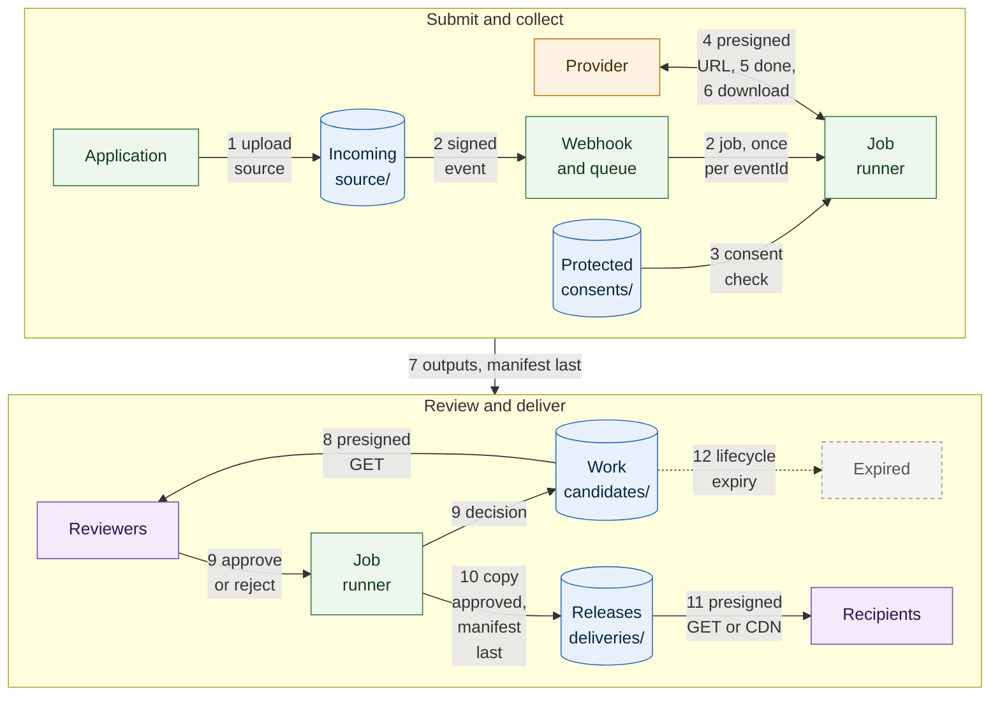

# Batch voice generation and dubbing

Run dubbing, text-to-speech and transcription jobs in batches against hosted or self-hosted providers, keep every output as a candidate that expires unless a reviewer approves it, and promote approved outputs to immutable, versioned deliveries with lineage back to the source and the job.

**Validation status:** `source-reviewed-and-automated-tests`. Every provider behavior on this page comes from the provider's own documentation, read on the dates in [Evidence](#evidence). The consent check, candidate, review URL, promotion, lineage and delivery-manifest steps are implemented by the [`voice-generation-artifacts`](../../applications/voice-generation-artifacts/README.md) application with a placeholder worker that produces synthetic audio, and its tests run in CI against an emulated S3 server. An opt-in live check of its storage operations (put, get, list, server-side copy, presigned GET, presigned URL expiry and delete) was run against a real B2 test bucket on 2026-10-16; a manual walkthrough of its `synth-source`, `submit`, `promote` and `deliver` commands against a real B2 test bucket with Object Lock followed on 2026-10-26, and a second manual run of the consent check on `submit` and of `review` the same day; bucket configuration, lifecycle expiry and the named providers were not validated live. The job manifest example is also validated against its schema in CI. See [Known limitations](#known-limitations).

> **Warning: presigned URL lifetime versus the provider's download window.** A hosted provider fetches the input from the presigned GET URL some time after the job is submitted, not at the moment of submission. If the URL expires before the provider has downloaded the file, the job fails. AssemblyAI documents this case: the origin answers `403` or `404` and the transcript fails with a download error. ElevenLabs and Deepgram do not document how long after submission they fetch a URL. Sign each URL immediately before the request that uses it, never cache signed URLs, give each one a lifetime longer than the provider's queue and download time (see [Presigned input and the download window](#presigned-input-and-the-download-window)), record that lifetime in the job manifest, and re-sign and resubmit when a job fails with a download error.

## When to use it

- You send recorded audio or video to a dubbing, speech synthesis or transcription service in batches and need to keep the inputs, the outputs and the decision on each output.
- Outputs must be reviewed before anyone downstream uses them, and unreviewed outputs must not accumulate.
- Approved outputs are delivered to other systems or people, and each delivery must be traceable to its source file, its job and the consent that allowed it.

## Data flow

Cylinders are B2 buckets (blue), green boxes are your own services, the orange box is the provider and purple boxes are people. The job runner appears once in each row: it is the same component. Each edge starts with the number of a step below; the steps and the tables later on this page hold the exact prefixes, keys and write order.

### Steps

1. The application uploads the source file (audio, video or a text script) to `source/` in the incoming bucket, with presigned PUT or multipart upload ([examples](../../examples/README.md#code-examples)). The object name carries a random id, never a speaker's name.
2. The Event Notification rule on `source/` ([template](../../examples/event-notifications.json)) calls a webhook. The receiver verifies the `X-Bz-Event-Notification-Signature` header, records the `eventId`, answers, and puts a job on a queue outside B2.
3. The job runner takes the job from the queue, reads the consent records named for the source from `consents/` in the protected bucket and refuses the job if any speaker's consent is missing, withdrawn, expired or does not cover the requested use (for example voice cloning in a dub).
4. The runner creates the job manifest (schema: [`generation-job-manifest.schema.json`](../../schemas/generation-job-manifest.schema.json)), signs a presigned GET URL for the source with a lifetime chosen for that provider, and submits the job. A hosted provider receives only the URL, fetches the source from the incoming bucket with it, and never receives a B2 key.
5. The provider reports completion through a callback or webhook, or the runner polls the provider's job status.
6. The runner downloads the outputs through the provider's API or the short-lived URLs the provider returns. Hosted providers do not write to B2: the application copies their results. A self-hosted model or the placeholder worker is the exception: it reads the source and writes `candidates/` itself with its own scoped keys (see [Running the job and collecting outputs](#running-the-job-and-collecting-outputs)).
7. The runner writes the mixed output, per-speaker stems where available, subtitles or transcripts, and finally the job manifest under `candidates/<job_id>/` in the work bucket. Each output is listed with its size, SHA-256 and the time at which lifecycle rules will remove it.
8. Reviewers listen to candidates through short-lived presigned GET URLs. The review tool holds no B2 key.
9. The review tool sends the approve or reject decision to the job runner, which records it (`review.status`, `review.decided_at`). In the application, an approval is recorded only in the manifest published in step 10; the manifest under `candidates/<job_id>/` is not rewritten and keeps `review.status` `pending`.
10. For an approved job, the runner copies the approved outputs to `deliveries/<release>/<version>/` in the releases bucket and writes the job manifest with its `promotion` block, including lineage, last. A delivery version is never rewritten.
11. Approved outputs reach recipients through short-lived presigned GET URLs or through a CDN worker in front of the private bucket that reads `deliveries/` with a read-only key.
12. The work bucket's lifecycle rule removes every candidate after the example period; approved outputs survive as copies in `deliveries/`, so only rejected and never-reviewed outputs are removed.

## Pipeline stages

### Job manifest

One manifest per job. It records the job kind (`dubbing`, `text-to-speech`, `transcription` or `call-analytics`), the provider and its mode (`hosted-api`, `self-hosted` or `placeholder`), the provider's job reference, the input key, version id and SHA-256, the presigned URL lifetime and the provider's download window, the consent ids, every output, the review decision and, once approved, the promotion and its lineage. The [example](../../manifests/generation-job-manifest.example.json) describes a two-speaker English source dubbed into Spanish.

The schema enforces the rules the workflow depends on: a succeeded job has at least one output, every output has an expiry, a review decision has a date, and a promotion exists only when the job succeeded and review approved it. The manifest never contains a presigned URL, because a URL is a bearer credential until it expires.

### Presigned input and the download window

| Provider | How it receives the input | What its documentation says about the fetch | Lifetime to choose |
|---|---|---|---|
| ElevenLabs Dubbing | `source_url` on project creation: "Public HTTP(S) URL the source media is fetched from server-side". A file upload (`file`) is the alternative. | Fetch time is not documented. Preparation "can take minutes on a long source". | Cover the expected queue time and preparation of the longest source. If the project fails, re-sign and create it again. |
| Deepgram (pre-recorded) | JSON body `{"url": "..."}` on `POST /v1/listen`. | Fetch time is not documented. Deepgram's own S3 presigned URL guide signs the GET URL for 10 minutes. | Without `callback`, the request waits for the result, so the URL only needs to outlive the request. With `callback`, the request returns at once and the fetch happens later: allow for that. |
| AssemblyAI | `audio_url` on `POST /v2/transcript`. | An expired URL makes the origin answer `403` or `404` and the transcript fails with a download error. Generate the URL "immediately before submitting", do not cache it, and make the window "at least a few minutes". Its S3 guide uses 30 minutes. | At least the documented minimum, longer for large files or queued submissions. The upload endpoint is the documented alternative when the lifetime cannot be controlled. |

Write the chosen lifetime to `input.delivery.expires_in_seconds` and, when the provider states one, its download window to `provider.download_window_seconds`; the manifest's description requires the URL to outlive the window. The schema caps the lifetime at seven days. A longer lifetime widens the time in which a leaked URL can be used, so sign one URL per job and per provider, for one object version, and never log it.

### Running the job and collecting outputs

| Provider | Completion signal | How the outputs are retrieved | Connection to B2 |
|---|---|---|---|
| ElevenLabs Dubbing | Workspace webhooks passed as `webhook_ids` receive `dubbing_project_ready` or `dubbing_project_failed`, then `dubbing_language_completed` or `dubbing_language_failed` per language. Delivery is best effort and can repeat. Polling the project and its language targets is the alternative. | The language target's `outputs` holds signed URLs for the dubbed audio (`lossless_audio`, FLAC) and subtitles (`subtitles`, WebVTT). They expire one hour after they are issued; reading the language target again returns fresh ones. | Application copy |
| Deepgram | The `callback` URL receives the result with `POST`, or `PUT` with `callback_method=put`. Non-2xx answers are retried up to 10 times, 30 seconds apart. Without `callback`, the response carries the result. | The callback body or the response is the transcript JSON. | Application copy. Deepgram also documents passing an S3 presigned PUT URL as the `callback`, so the transcript is written straight to the bucket; that path is outside this repository's validation scope. |
| AssemblyAI | `webhook_url` receives `transcript_id` and `status` (`completed` or `error`), with an optional custom header set by `webhook_auth_header_name` and `webhook_auth_header_value`. The endpoint must answer 2xx within 10 seconds. Polling `GET /v2/transcript/{transcript_id}` is the alternative. | `GET /v2/transcript/{transcript_id}`; the webhook does not carry the transcript. | Application copy |
| Self-hosted model or placeholder worker | The worker's own job status. | The worker writes outputs itself. | The worker reads the source with a read key or a presigned GET URL and writes `candidates/` with a scoped key. |

The completion handler is idempotent: callbacks and webhooks can arrive more than once, and polling may observe the same completion again. It keys on the provider's job reference, writes outputs under the job's own prefix, and writes the job manifest last, so a repeated completion overwrites the same keys with the same content. Verify each provider's signature or header before trusting a callback; Deepgram documents that its `dg-token` header is not guaranteed on every request and recommends it only as a supplementary check.

Download a provider's output URL as soon as the completion arrives and verify the size before writing to B2; if the URL has expired, ask the provider for a fresh one rather than storing the old one. Large outputs use multipart upload with resume.

### Per-speaker stems

A stem is one speaker's track for one language, stored as `candidates/<job_id>/<language>/<speaker_id>.wav` beside the mix and listed in the manifest with `kind: stem` and the `speaker_id`. Stems let a reviewer judge each voice separately and let an editor remix without regenerating the job.

Where stems come from depends on the provider. The ElevenLabs Dubbing project API returns the dubbed track and subtitles; per-speaker tracks are documented as a Dubbing Studio export (".zip of audio tracks"), which the application uploads as stems after an operator exports them. A self-hosted generator, or the placeholder worker, writes stems directly. When no stems exist, the manifest lists only the mix.

### Review and promotion

Review happens on candidates only. A candidate is never edited: a correction is a new job, with a new `job_id`, whose manifest names the same input.

Promotion copies the approved outputs to `deliveries/<release>/<version>/` and writes the job manifest there last, with:

- `promotion.release_id` as `<release>@<version>` and `promotion.version`;
- `promotion.lineage.job_id`, `input_sha256` (the source version that was submitted) and `output_sha256` (the outputs that were approved).

Readers resolve a delivery by its release id and check the hashes after download. Any change, including a re-dub of one line, is a new version.

### Delivery

- **Few recipients.** Short-lived presigned GET URLs for the delivery objects, issued per recipient by the application. A [delivery manifest](../../schemas/delivery-manifest.schema.json) can carry the URLs and their expiry to the recipient's system.
- **Repeated or wide distribution.** A CDN worker in front of the private releases bucket signs requests to B2 with a key scoped to `deliveries/`; the bucket stays private and the key never reaches clients. Per-user authorization belongs to the CDN or the application ([capability map](../../docs/b2-capabilities.md)).
- **Compute partners.** A downstream job at a partner reads `deliveries/` with a read-only, expiring key.

### Expiry of candidates

Lifecycle on `candidates/` hides objects after the example period and deletes them the next day ([`lifecycle-work.json`](../../examples/lifecycle-work.json)). The runner computes each output's `expires_at` from that period, so reviewers can see how long a candidate remains. Promotion copies outputs, so expiry of the candidate never affects a delivery. Job manifests of rejected jobs expire with their candidates; if a record of rejections must be kept longer, the application keeps it in its own database.

## Batch transcription and call analytics

The same pipeline handles transcription and call analytics: the source is a recorded call or meeting, the job kind is `transcription` or `call-analytics`, and the outputs are transcripts and analysis files with `kind: transcript`.

- **Inputs.** Recordings land in `source/`, or are selected from a session archive by the application. Two-channel call recordings can be sent as they are; mono recordings need speaker diarization.
- **Provider features.** Deepgram documents speaker diarization (`diarize_model`; `diarize=true` is deprecated), redaction, and, for English, sentiment analysis, intent recognition, topic detection and summarization. AssemblyAI documents speaker diarization (`speaker_labels`), PII redaction (`redact_pii`), sentiment analysis, entity detection and topic detection (`iab_categories`); its `summarization` and `auto_chapters` parameters are marked deprecated. Enable only the features the use case needs.
- **Outputs.** The provider's JSON is stored unchanged as `candidates/<job_id>/transcript.json`, so it can be re-parsed later, together with any derived file the application produces (for example per-speaker talk time or a redacted plain-text transcript). The manifest lists each file with its hash.
- **Review and promotion.** Transcripts used for analytics or as training labels go through the same review and promotion. Approved transcripts that become training data move into the [voice training data lifecycle](../voice-training-data-lifecycle/architecture.md) as candidates with their consent ids.
- **Personal data.** Transcripts of calls contain names, numbers and account details. Request redaction from the provider where it is documented for the language, store unredacted provider output only in `candidates/` where it expires, and keep object names and metadata free of personal data.
- **Analytics storage.** B2 keeps the transcript and analysis files; queries across many calls run in a database or warehouse loaded from them.

## Boundaries

What B2 is not in this workflow, and what does that job instead.

| Boundary | B2 is not | What does it instead |
|---|---|---|
| Real-time voice transport | B2 does not stream synthesized speech or live call audio to listeners. This workflow handles finished files in batches. | The provider's streaming API or a WebRTC stack, outside this workflow. |
| Low-latency conversational session store | B2 holds no job state that must be read or updated on every request. | The job runner's database; the job manifest in B2 is the durable record written at each stage. |
| Message queue | Event Notifications start jobs, but delivery is at least once and the webhook must answer quickly; B2 does not schedule, retry or order jobs. | A queue or job runner outside B2. |
| Transcription or voice generation model | B2 stores sources, outputs and manifests; it does not dub, synthesize, transcribe or analyze speech. | ElevenLabs, Deepgram, AssemblyAI, a self-hosted model or the placeholder worker. |
| Workflow orchestrator | B2 does not submit jobs, poll providers, wait for review or run promotion. | The job runner or an orchestrator. |
| Metadata catalog | Object names and manifests are not a searchable index of jobs, speakers, languages and decisions. | The application database or a data catalog loaded from the manifests. |
| Vector database | B2 does not index speaker or content embeddings for search or deduplication. | A vector database; embedding files can be stored as job outputs. |
| Local GPU cache or high-throughput training storage | For self-hosted models, B2 is the source of model weights and inputs, not the store a GPU reads from on every step. | Local disk on the GPU host, filled from B2 with a read key. |

## Where B2 does not fit

- **Interactive speech synthesis.** A user waiting for speech needs a streaming response from the provider; writing to B2 and reading back adds a round trip. Store the result afterwards if it must be kept.
- **Provider-side editing.** Edits made in a provider's editor (for example Dubbing Studio) live in the provider until they are exported; B2 holds what the application exports and copies.
- **Native provider output to B2.** The hosted providers in this workflow return results through their APIs or short-lived URLs; none writes to a B2 bucket as a configured destination. The application performs the copy.
- **Cross-call search and dashboards.** B2 holds transcripts and analysis files; filtering and aggregating across calls belongs in a database or warehouse.
- **Single files processed once.** If a file is dubbed once and its output is used once, a direct upload to the provider and a local copy of the result are simpler than this pipeline.

## Object layout

Summary; the full layout, keys and lifecycle are in [`object-layout.md`](object-layout.md).

| Zone | Bucket | Prefixes |
|---|---|---|
| Incoming | `<prefix>-voice-generation-incoming` | `source/` |
| Work | `<prefix>-voice-generation-work` | `candidates/`, `scratch/` |
| Releases | `<prefix>-voice-generation-releases` | `deliveries/` |
| Protected | `<prefix>-voice-generation-protected` | `consents/` |

One bucket per zone, because lifecycle, Object Lock, replication, encryption defaults and notification rules are set per bucket and an application key admits one prefix. [`provision.py`](../../infrastructure/b2-provisioning/provision.py) prints the commands for exactly these buckets and keys. There is no per-tenant prefix.

## Security

- **Keys.** One application key per component and prefix: the source uploader writes `source/` only; the job runner reads `source/` and `consents/`, writes `candidates/` and writes `deliveries/` through separate keys; a CDN worker reads `deliveries/` only. No key is ever sent to a hosted provider. No application key has `deleteFiles`, `bypassGovernance` or `writeKeys` unless its job requires it. See the [scoped key examples](../../examples/README.md#scoped-application-keys).
- **Presigned URLs.** One URL per object version and per provider, signed just before use, with a lifetime set from the table above. Review and delivery URLs are short-lived GETs. A presigned URL is a bearer credential until it expires: do not log it or store it in a manifest.
- **Provider outputs.** Provider download URLs are also bearer credentials. Fetch them server-side, verify size and hash, and discard them.
- **Callbacks and webhooks.** Verify the B2 Event Notification signature on the raw body ([`notifications.py`](../../examples/python/notifications.py)), the ElevenLabs webhook signature (`ElevenLabs-Signature`), and the credentials you configured for Deepgram and AssemblyAI callbacks (basic authentication in the callback URL, or a custom header). Process each event once.
- **Encryption.** SSE-B2 is the default on every bucket ([template](../../examples/encryption.json)). Object names, bucket names and metadata are not encrypted, so they carry job ids and pseudonymous speaker ids only.
- **CORS.** Allow `GET` and `HEAD` from the review tool's origin on the work bucket only if the review tool plays audio in the browser from presigned URLs.

### Consent and voice rights

- Dubbing can clone the voices in the source. Each speaker's consent record states whether voice cloning and generation are permitted, and the runner checks it before submitting. ElevenLabs reports speakers whose voices were not permitted for cloning and for whom a replacement voice was used; record that in the review notes.
- Sending a recording to a hosted provider is a transfer of personal data to a processor. Check the provider's retention and data-use terms against the consent before submitting.
- A consent withdrawal stops new jobs for that speaker. Deliveries that contain the speaker's voice are hidden so the releases lifecycle removes them after the grace period; copies already delivered to recipients are outside storage.

### Retention

| Data | Retention mechanism |
|---|---|
| Sources | Lifecycle on `source/`: hidden after the example period and deleted the day after ([`lifecycle-incoming.json`](../../examples/lifecycle-incoming.json)). |
| Candidates and job manifests | Lifecycle on `candidates/`; unpromoted outputs expire. |
| Scratch output of self-hosted workers | Short lifecycle on `scratch/`. |
| Deliveries | Current versions kept; hidden versions deleted after a grace period ([`lifecycle-releases.json`](../../examples/lifecycle-releases.json)). |
| Consent records | Object Lock governance retention, plus legal hold where required. |

The day counts are examples, not recommendations. Applying a lifecycle template replaces all of a bucket's lifecycle rules.

### Provenance

The job manifest links the source version and its SHA-256, the provider and its job reference, the parameters, the consent ids, every output hash and the review decision. The promoted copy adds the release id and the lineage block, so any delivered file can be traced back to the exact source version and job that produced it.

### Access

| Who | Access |
|---|---|
| Source uploader | Presigned PUT for one object in `source/`, or a write-only key on `source/` |
| Job runner | Read `source/`, `consents/`; write `candidates/`; write `deliveries/` (separate key) |
| Hosted provider | One presigned GET URL per job; no key |
| Self-hosted worker | Read `source/`; write `candidates/` and `scratch/` |
| Reviewers | Presigned GET on `candidates/` through the review tool; no key |
| Recipients | Presigned GET on one delivery, or the CDN |
| CDN worker | Read-only key on `deliveries/` |
| Auditors | Read-only on `consents/`, including retention and legal hold |

## Evidence

All entries were read on the date shown. Product behavior can change; the linked pages are authoritative.

| Date | Source | What it supports |
|---|---|---|
| 2026-10-15 | [ElevenLabs: create dubbing project](https://elevenlabs.io/docs/api-reference/dubbing/create-project), [get project](https://elevenlabs.io/docs/api-reference/dubbing/get-project), [get language target](https://elevenlabs.io/docs/api-reference/dubbing/language-targets/get-language-target), [dubbing quickstart](https://elevenlabs.io/docs/eleven-api/guides/cookbooks/dubbing) | `source_url` fetched server-side or `file` upload; project and language target statuses; `webhook_ids` events, best-effort and repeatable delivery; `outputs.lossless_audio` (FLAC) and `outputs.subtitles` (WebVTT) as signed URLs that expire one hour after issue; speakers not permitted for cloning |
| 2026-10-15 | [ElevenLabs webhooks](https://elevenlabs.io/docs/eleven-api/resources/webhooks) | HMAC signature in the `ElevenLabs-Signature` header, retries, idempotent handling |
| 2026-10-15 | [ElevenLabs Dubbing Studio](https://elevenlabs.io/docs/eleven-creative/products/dubbing/dubbing-studio) | Export formats, including a .zip of audio tracks |
| 2026-10-15 | [Deepgram pre-recorded audio](https://developers.deepgram.com/docs/pre-recorded-audio), [callback](https://developers.deepgram.com/docs/callback), [S3 presigned URLs and Deepgram](https://developers.deepgram.com/docs/using-aws-s3-presigned-urls-with-the-deepgram-api) | Remote file by `url`; `callback` and `callback_method`, `request_id`, 10 retries 30 seconds apart, basic authentication and `dg-token`; presigned GET as input and presigned PUT as callback, documented for AWS S3 |
| 2026-10-15 | [Deepgram diarization](https://developers.deepgram.com/docs/diarization), [pre-recorded feature overview](https://developers.deepgram.com/docs/stt-pre-recorded-feature-overview) | `diarize_model`, `diarize=true` deprecated; redaction; sentiment, intents, topics and summarization for English |
| 2026-10-15 | [AssemblyAI common errors and solutions](https://www.assemblyai.com/docs/pre-recorded-audio/guides/common_errors_and_solutions), [transcribe from S3](https://www.assemblyai.com/docs/pre-recorded-audio/guides/transcribe_from_s3) | Expired presigned URL causes `403` or `404` and a download error; generate immediately before submitting; window of at least a few minutes; 30-minute example; upload endpoint as the alternative |
| 2026-10-15 | [AssemblyAI submit transcript](https://www.assemblyai.com/docs/api-reference/transcripts/submit), [webhooks](https://www.assemblyai.com/docs/deployment/webhooks) | `audio_url`, `webhook_url`, `webhook_auth_header_name`, `speaker_labels`, `redact_pii`, `sentiment_analysis`, `entity_detection`, `iab_categories`, deprecated `summarization` and `auto_chapters`; webhook body with `transcript_id` and `status`, 2xx within 10 seconds, transcript fetched with `GET /v2/transcript/{transcript_id}` |
| 2026-10-15 | [B2 capability map](../../docs/b2-capabilities.md) and the Backblaze pages it links | Presigned URLs, Event Notifications, application keys, lifecycle rules, Object Lock, encryption, private delivery through a CDN, compute partners |
| 2026-10-15 | [`applications/voice-generation-artifacts/tests/`](../../applications/voice-generation-artifacts/tests) | Candidates under the candidates prefix, per-speaker stems, promotion by server-side copy with lineage, a version written once and a delivery manifest with bounded presigned URLs behave as described, against an emulated S3 server and a placeholder worker |
| 2026-10-16 | [`applications/voice-generation-artifacts/tests/test_live.py`](../../applications/voice-generation-artifacts/tests/test_live.py) | Run once against a real B2 test bucket, writing only under a unique `live-test/<uuid>/` prefix and deleting what it wrote: authentication and the endpoint derived from the region, put, get, list, server-side copy, presigned GET through the real endpoint, expiry of a presigned URL (B2 answered HTTP 401 on that date; observed behavior, not a documented guarantee) and delete |
| 2026-10-26 | Manual walkthrough of the `voice-generation-artifacts` commands (not `tests/test_live.py`) against a real B2 test bucket with Object Lock and SSE-B2, using a key without `deleteFiles` | `synth-source --put`, `submit` (two languages, two speakers, six outputs), `promote --approve` (six objects copied to the version prefix) and `deliver` (seven presigned URLs answered 200; an unsigned GET answered 401); the job manifest was the last object written under the candidate prefix and the version prefix; the delivered objects matched the manifest SHA-256 and the manifest held no signed URL; objects reported SSE AES256 and no Object Lock retention (the tool sets none); a repeated submit, a promote without `--approve`, a repeated promote, an out-of-range expiry, a bad source id, a missing source and a nonexistent attempt were refused. Candidate expiry by lifecycle and cleanup were not observed |
| 2026-10-26 | Second manual run of the changed `voice-generation-artifacts` commands (not `tests/test_live.py`) against a real B2 test bucket with Object Lock and SSE-B2, using a key without `deleteFiles` | `submit` with a valid consent record for each speaker succeeded and recorded the consent ids in the job manifest. `submit` was refused with exit code 2, and nothing was found under that job's candidate or release prefix (listed read-only), for a consent id with no record, for a record of another speaker and for a job in which one speaker had no record. `review` printed six presigned URLs; one answered 200 and the same URL without its signature answered 401; with `--out` the URLs went to a file readable by its owner only and the printed summary held none; an out-of-range `--expires` and a nonexistent attempt were refused with exit code 2. `promote --approve` and `deliver` then ran as before. |

## Known limitations

- Per-tenant isolation is not covered. The layout assumes a single organization; separate tenants need their own buckets and keys.
- Live validation is limited to what the Evidence section lists: storage operations on 2026-10-16 and manual runs of the commands on 2026-10-26. Outside the live runs: lifecycle expiry of candidates and cleanup; bucket configuration (lifecycle, CORS, Event Notification, replication and encryption templates are checked for shape only), and ElevenLabs, Deepgram and AssemblyAI. Provider behavior is taken from their documentation on the dates above. The application's CI tests run against an emulated S3 server.
- ElevenLabs and Deepgram do not document how long after submission they fetch an input URL; the lifetimes on this page are guidance, not measured values.
- Deepgram's presigned PUT callback is documented for AWS S3; using it with a B2 presigned PUT URL is outside the validation scope.
- Per-speaker stems from ElevenLabs are covered only as a Dubbing Studio export; the project API outputs described here are the dubbed track and subtitles.
- The [`voice-generation-artifacts`](../../applications/voice-generation-artifacts/README.md) application covers the consent check before a job (every speaker needs an active, unexpired record that permits `generation`), submitting a job to a worker, candidates and stems, short-lived review URLs for the candidates, promotion by copy with lineage and delivery manifests, in a single bucket with zone prefixes. Its only worker is a placeholder that writes synthetic tones. The review interface, the consent service that writes the records, the check of voice cloning terms and the provider adapter are components of your deployment; the repository provides the job manifest schema and example, the configuration templates and the provisioning helper they use.
- After a consent withdrawal, copies already delivered to recipients are held outside storage and are handled with those recipients.
