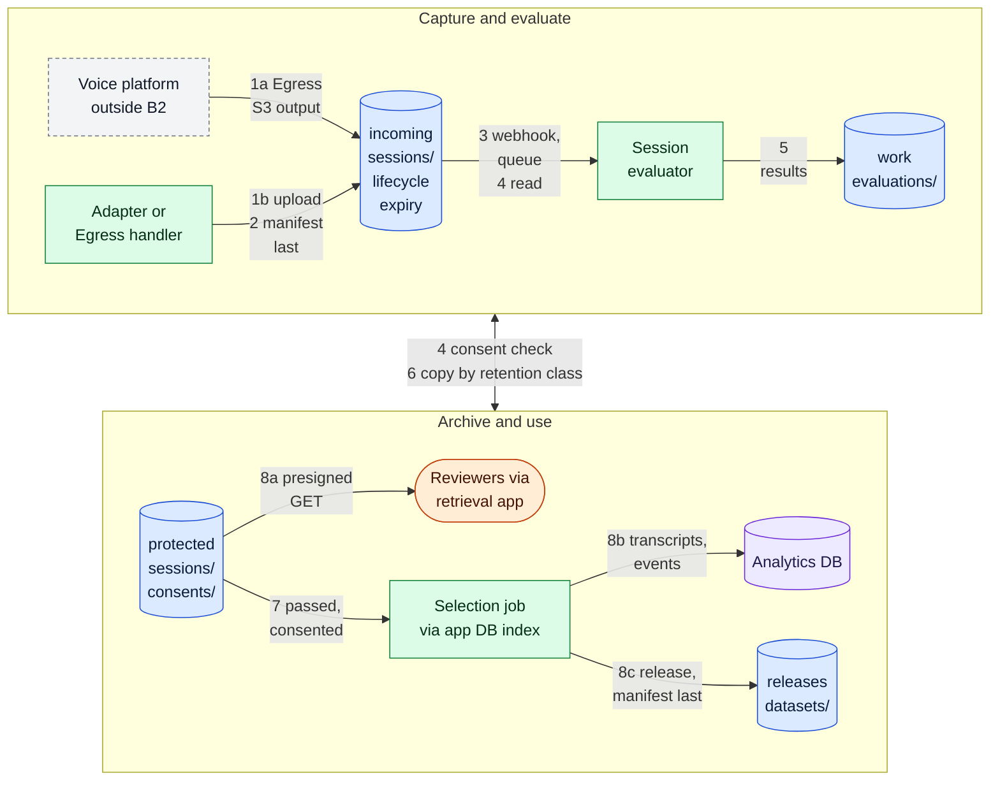

# Voice agent session archive

Archive finished voice agent sessions (recordings, transcripts, events and a session manifest) in B2, evaluate each session for quality and safety, keep it for the retention its class requires, and let only sessions that passed evaluation and are covered by consent be selected for human review, analytics or model improvement.

**Validation status:** `source-reviewed-and-automated-tests`. Platform behavior on this page comes from each platform's own documentation, read on the dates in [Evidence](#evidence). The LiveKit path (Egress writing to B2, the verified `egress_ended` webhook processed once per event id, the session manifest written last and the evaluation step) is implemented by the [`voice-session-archive`](../../applications/voice-session-archive/README.md) application, and its tests run in CI against an emulated S3 server with signed sample webhooks. An opt-in live check of its storage operations (put, head, get, the recording written before the manifest, the manifest round trip and delete) was run against a real B2 test bucket on 2026-10-16, without a LiveKit server. A manual walkthrough of its commands against a real B2 test bucket with Object Lock, with a stand-in for Egress, followed on 2026-10-26; LiveKit Egress, real webhook delivery, the named platforms and bucket configuration were not validated live. The session manifest example and the synthetic session fixture are validated against their schema in CI, and the [LiveKit Egress request template](../../infrastructure/livekit-egress/README.md) is checked for shape in CI. See [Known limitations](#known-limitations).

B2 is never in the live audio path. The voice platform carries the conversation in real time; B2 receives the recordings after they are written and holds them durably from then on.

## When to use it

- A voice agent (on LiveKit, Pipecat, Twilio, Daily, Vapi or your own stack) handles calls or sessions that must be kept for support, quality assurance, compliance or later model improvement.
- Recordings must be traceable to the consent that covers them, kept for a defined period and removed when that period ends or consent is withdrawn.
- Only sessions that meet quality and safety rules may reach reviewers, analytics or training data.

## Data flow

The diagram is the overview; the numbered steps below it carry the full detail (keys, ordering and conditions). Each arrow starts with the number of its step. Colours: blue cylinders are B2 buckets, the purple cylinder is a database outside B2, green boxes are the operator's services, the grey dashed box is the external voice platform, and orange marks people. The arrow between the two groups stands for the evaluator reading consent records from the protected bucket (4) and copying sessions into it (6).

| Voice platform | Path to the incoming bucket |
|---|---|
| LiveKit | 1a. Egress writes the recording through B2's S3-compatible endpoint; the `egress_ended` handler writes the manifest |
| Pipecat, Twilio, Daily, Vapi | 1b. A session adapter downloads (or, for Pipecat, receives) the recording, uploads it and writes the manifest |

### Steps

1. While the session runs, the platform carries the audio; B2 is not in the live audio path. When recording is enabled, the recording reaches the incoming bucket's `sessions/<session_id>/` prefix by one of two paths: LiveKit Egress writes it directly through B2's S3-compatible endpoint (1a), or a session adapter receives the platform's completion callback, downloads the recording from the platform and uploads it to B2 (1b).
2. When the session has ended and every file is in place, the adapter (or, for Egress, the handler of the `egress_ended` webhook) writes `sessions/<session_id>/session-manifest.json` last, with `evaluation.status` set to `pending` and an empty `eligible_for`.
3. The Event Notification rule on `sessions/` ([template](../../examples/event-notifications.json), rule `evaluate-sessions`) calls a webhook. The receiver, which holds no B2 key, verifies the `X-Bz-Event-Notification-Signature` header on the raw body, records the `eventId`, answers, and queues an evaluation on a queue outside B2 only for objects named `session-manifest.json`; events for the recording files themselves are acknowledged and ignored.
4. The evaluator reads the manifest and the recordings from the incoming bucket with a read key, checks every listed file's size and SHA-256, and reads the consent records the manifest names from `consents/` in the protected bucket.
5. It runs the quality and safety checks described in [Session evaluation](#session-evaluation) and writes the detailed results to `evaluations/<session_id>/` in the work bucket.
6. For sessions whose retention class requires archiving (`standard`, `extended` and `legal-hold`), the evaluator copies the recordings to `sessions/<session_id>/` in the protected bucket, sets per-object retention or a legal hold for the class, and writes the manifest with its completed `evaluation` block there last. Sessions in the `short` class are not copied. The incoming copy expires through lifecycle.
7. A selection job reads evaluated manifests from the protected bucket (through an index in the application database) and selects only sessions whose evaluation `passed`, whose `eligible_for` names the use, and whose consent is still active and covers that use at selection time; it reads the latest version of each consent record in `consents/` again to check this.
8. Selected sessions reach reviewers through short-lived presigned GET URLs for files in the protected bucket, issued by the application after it authorizes the person and records the access (8a), feed an analytics database through their transcripts and events (8b), or become part of a versioned dataset release under `datasets/` in the releases bucket, with the release manifest written last (8c).

## Capture paths

| Platform | How the recording is produced | How it reaches B2 | Connection to B2 |
|---|---|---|---|
| LiveKit (Egress) | Room composite or track Egress records the room or the agent and caller tracks. | Egress uploads the file through the `s3` output with the B2 endpoint and `force_path_style`; Backblaze is listed by LiveKit as an S3-compatible provider. | Native S3 output |
| Pipecat | `AudioBufferProcessor` buffers user and bot audio and emits it through `on_audio_data` (mixed or two-channel) and `on_track_audio_data` (one mono track each). | The application converts the PCM to WAV and uploads it. Pipecat documents no built-in storage upload. | Application copy |
| Twilio | Call or conference recording; recordings are kept in Twilio's storage, or in an AWS S3 bucket when external storage is configured. | The `recordingStatusCallback` reports `completed` with `RecordingSid` and `RecordingUrl`; the adapter downloads the media with HTTP Basic authentication and uploads it to B2. | Application copy |
| Daily | Cloud or raw-tracks recording; recordings are kept in Daily's storage, or in an AWS S3 bucket (Daily assumes an IAM role) when a custom bucket is configured. | The `recording.ready-to-download` webhook reports the `recording_id`; the adapter requests a download link from the recording access link API and uploads the file to B2. | Application copy |
| Vapi | Call recording through the assistant's `artifactPlan`; kept in Vapi's storage by default, or in a configured custom bucket. | After the call, the adapter calls the authenticated artifact endpoints (for example `GET /call/{id}/stereo-recording`), follows the redirect to the short-lived signed URL and uploads the file to B2. The `end-of-call-report` server event signals the end of the call. | Application copy |

### LiveKit Egress (main path)

LiveKit Egress is the one platform here that writes to B2 itself. The [Egress template](../../infrastructure/livekit-egress/README.md) requests an audio-only room recording with `audio_mixing: DUAL_CHANNEL_AGENT` (agent audio on the left channel, everyone else on the right), written as OGG to `sessions/{room_name}/{time}` in the incoming bucket. Use the session id as the room name so the prefix is the session prefix.

- **Key.** The Egress request carries a key limited to the incoming bucket and the `sessions/` prefix ([`provision.py`](../../infrastructure/b2-provisioning/provision.py) creates `voice-sessions-incoming-sessions`). The request contains the key, so it is built server-side and never logged.
- **End of the recording.** LiveKit sends `egress_started`, `egress_updated` and `egress_ended` webhooks, signed with a JWT in the `Authorization` header that carries a SHA-256 of the body. The `egress_ended` event carries the egress result; its file information includes `filename`, `size`, `duration` (in nanoseconds) and `location`, and its status is `EGRESS_COMPLETE` on success. The handler checks the status, compares the stored object's size with the reported size, computes the SHA-256, and only then writes the session manifest.
- **Egress manifest.** Egress also uploads its own JSON manifest unless `disable_manifest` is set; keep it inside the session prefix or disable it. It does not replace the session manifest, which carries consent, retention and evaluation.
- **Delivery of webhooks.** LiveKit retries webhook requests but states that delivery is not guaranteed. If no `egress_ended` arrives within the session's expected end, the handler queries the egress by id and writes the manifest from that result.
- **Request shape.** `audio_mixing` is marked deprecated in favor of audio routes in `StartEgress`; the [template README](../../infrastructure/livekit-egress/README.md#notes-and-limits) explains how the same `s3` block moves to the newer request.

### Pipecat adapter notes

Pipecat runs the agent pipeline over a transport such as Daily or LiveKit; the recording can come from the transport platform (use that platform's path above) or from Pipecat itself.

- Add `AudioBufferProcessor` to the pipeline with `num_channels=2` to keep the caller on the left channel and the bot on the right, or handle `on_track_audio_data` to keep each side as its own mono track.
- With `buffer_size=0` the handlers run once, when recording stops. With a positive `buffer_size` they run each time the buffer fills; upload each chunk as a part of a [multipart upload](../../examples/README.md#code-examples) under the session prefix and complete it when the session ends, so a long session never sits only in memory.
- Write the WAV files, then the session manifest with `source.platform: pipecat` and `source.capture: application-copy`, last.

### Twilio, Daily and Vapi adapter notes

These three platforms store recordings in their own storage or, optionally, in a bucket they write to themselves. The custom storage documented by Twilio and Daily is AWS S3 only (Daily also documents Oracle Cloud through its support team); neither documents a custom S3-compatible endpoint, so neither writes to B2 directly. Vapi documents AWS S3, Google Cloud Storage, Cloudflare R2, Supabase Storage and Azure Blob Storage as custom destinations, and none of these is B2. This architecture does not present any of them as a native integration. The pattern is the same for all three:

1. **Callback.** Receive the platform's completion signal and verify it: Twilio signs requests with `X-Twilio-Signature` (HMAC-SHA1 with the account auth token); Daily signs webhooks with `X-Webhook-Signature` and `X-Webhook-Timestamp` (HMAC-SHA256 with the webhook's base64 secret); Vapi's server event documentation does not describe a signature, so treat a Vapi event only as a trigger: the adapter takes the call id from it and fetches everything else from Vapi's authenticated API, never from the event body. Process each event once.
2. **Download.** Fetch the recording server-side with the platform's credentials:
   - Twilio: `GET .../Recordings/{Sid}.wav` (or `.mp3`) with HTTP Basic authentication, available when the status is `completed`. Recordings are dual-channel by default for calls and conferences; request `RequestedChannels=2` to keep the channels. If external AWS S3 storage is enabled, the media is no longer served by Twilio and the adapter must read it from that bucket instead.
   - Daily: `GET /recordings/{recording_id}/access-link` returns a `download_link` and its `expires`; links for recordings in a customer's AWS bucket last at most one hour. Use the link exactly as returned and request a new one if it expired.
   - Vapi: the artifact endpoints (`mono-recording`, `stereo-recording`, `customer-recording`, `assistant-recording`, `call-logs`) answer with a redirect to a signed URL that expires after a short period; do not cache it.
3. **Write to B2.** Upload each file to `sessions/<session_id>/` in the incoming bucket with a key limited to `sessions/`, using multipart upload with resume for long recordings, and verify size and SHA-256 after upload.
4. **Manifest at the end.** Write the session manifest last, with `source.capture: application-copy`, so its arrival means every file it lists exists.
5. **Optional removal at the platform.** Once B2 holds the verified copy, the adapter can delete the platform's copy where the platform supports it: Twilio's `DELETE .../Recordings/{Sid}.json` removes the media for `completed` recordings and keeps metadata for 40 days; Daily documents `DELETE /recordings/{recording_id}`, but its documentation does not say whether that also removes a file in a customer-managed bucket. Do this only if the platform's copy is not needed for the platform's own features.

The repository ships these steps as integration notes for a Twilio, Daily or Vapi adapter.

## Session manifest

One manifest per session, written when the session has ended (schema: [`session-manifest.schema.json`](../../schemas/session-manifest.schema.json); [example](../../manifests/session-manifest.example.json); a two-speaker synthetic session in [`testdata/synthetic-speech/session/`](../../testdata/synthetic-speech/README.md)). It records:

- the session id, start, end and duration;
- the platform and whether the capture was `native-s3-output` or `application-copy`;
- the participants by pseudonymous id and role (`caller`, `agent`, `observer`);
- every recording, transcript and event file, with its path relative to the session prefix, size, SHA-256, encoding and, for audio, sample rate, channels and duration;
- the consent ids that cover the recordings;
- the retention class (`short`, `standard`, `extended`, `legal-hold`) and, where it applies, `delete_after`;
- the evaluation block.

The validator checks the example and the fixture against the schema and checks rules a schema cannot express, such as the declared duration against the start and end times and, for the fixture, against the WAV headers. A manifest never contains a presigned URL or a platform download link, because both are bearer credentials until they expire.

## Session evaluation

Every session is evaluated for quality and safety before it can be selected for human review, analytics or model improvement. Until the evaluation completes, the session's `evaluation.status` is `pending` and `eligible_for` is empty, so no selection job can pick it.

**Quality checks** confirm that the recording is usable:

| Check | What it verifies |
|---|---|
| Integrity | Every listed file exists, and its size and SHA-256 match the manifest. |
| Audio format | Encoding, sample rate and channel layout match what the manifest declares (for example two channels for a dual-channel Egress recording). |
| Duration | Recording durations agree with the session's start and end within a tolerance. |
| Speech present | Each participant track contains speech, not only silence or noise. |
| Level and clipping | The signal is not clipped and not too quiet to transcribe. |
| Transcript coverage | Where a transcript exists, it covers the session and names each participant. |

**Safety checks** confirm that the session may be used at all:

| Check | What it verifies |
|---|---|
| Consent active | Each consent id has a record in `consents/`, its latest version is `active` and not expired, and it covers every participant whose voice is kept. |
| Purpose covered | The consent's `permitted_uses` cover each use the session is made eligible for (see the mapping below). |
| Sensitive identifiers | Transcripts and events are scanned for account numbers, payment card numbers and similar identifiers; a session that contains them is flagged unless they were redacted. |
| Content policy | Agent and caller turns are checked against the operator's content policy (for example abusive content or unsafe agent answers). |
| Participant restrictions | Sessions whose participants must not be retained for secondary use under the operator's policy are excluded. |

**Outcome.** The evaluator writes one result object per run to `evaluations/<session_id>/<evaluator-version>.json` and fills the manifest's `evaluation` block with `status`, `evaluated_at`, `evaluator` (name and version), the `quality` and `safety` groups with each check's result, and `eligible_for`. The schema enforces the selection rules:

- `pending`, `flagged` and `failed` require an empty `eligible_for`;
- `passed` requires both groups to be `pass`;
- `model-improvement` in `eligible_for` requires at least one consent id.

`eligible_for` lists only the uses that consent permits, with this mapping to the consent record's `permitted_uses`: `human-review` needs `evaluation`, `analytics` needs `analytics`, and `model-improvement` needs `training`.

**Flagged and failed sessions.** They stay archived according to their retention class but cannot be selected. They are handled in a restricted triage outside the selection path; after triage, a new evaluator run writes a new result and a new version of the manifest. A changed evaluator version also re-evaluates by writing a new result, never by editing an earlier one.

The evaluator is the operator's own component; this repository defines its inputs and outputs (the manifest schema and the result location), not its models or rules.

## Retention per zone

| Zone and prefix | What it holds | Retention mechanism |
|---|---|---|
| Incoming, `sessions/` | Every captured session as written by Egress or an adapter | Lifecycle: hidden after the example period and deleted the next day ([`lifecycle-incoming.json`](../../examples/lifecycle-incoming.json)). Sessions in the `short` class live only here. |
| Work, `evaluations/` | Evaluation results | Current versions kept; superseded versions deleted after the example period ([`lifecycle-work.json`](../../examples/lifecycle-work.json)). |
| Work, `scratch/` | Temporary files of the evaluator (decoded audio, intermediate transcripts) | Short lifecycle. |
| Protected, `sessions/` | Sessions in the `standard`, `extended` and `legal-hold` classes | Object Lock: bucket default retention in governance mode ([`object-lock.json`](../../examples/object-lock.json)), extended per object to the class's period; a legal hold for `legal-hold`. A retention job deletes versions after `delete_after` once retention ends. |
| Protected, `consents/` | Consent records | Object Lock governance retention, plus legal hold where required. |
| Releases, `datasets/` | Dataset releases built from selected sessions | Current versions kept; hidden versions deleted after a grace period ([`lifecycle-releases.json`](../../examples/lifecycle-releases.json)). |

The protected bucket's lifecycle template only cancels unfinished uploads, because lifecycle rules cannot delete versions under Object Lock and the retention period differs by class. The day counts are examples, not recommendations; set them from your own retention policy and consent terms. Applying a lifecycle template replaces all of a bucket's lifecycle rules.

## Retrieval

Sessions are never served from a public bucket. Support staff, reviewers and auditors open a session through the application, which checks the person's authorization, records the access, and issues short-lived presigned GET URLs for the specific files of one session in the protected bucket. The review tool holds no B2 key. For browser playback, allow `GET` and `HEAD` from the review tool's origin in the protected bucket's CORS rules ([template](../../examples/cors.s3.json)).

## Selection into datasets

A session enters training or evaluation data only through a selection job:

1. It reads candidate sessions from the application database, which is loaded from the evaluated manifests in the protected bucket.
2. It keeps only sessions with `evaluation.status: passed` and `model-improvement` in `eligible_for`.
3. It reads the latest version of each consent record again and drops any session whose consent was withdrawn or expired after the evaluation.
4. It extracts the audio and transcripts needed (for example per-speaker segments with redacted transcripts), writes them with the consent ids and the source session id, and builds a versioned release under `datasets/<dataset>/<version>/` in the releases bucket with a [release manifest](../../schemas/release-manifest.schema.json), or hands them as contributions to the [voice training data lifecycle](../voice-training-data-lifecycle/architecture.md).

The release manifest lists every file with its hash and the session and consent ids it came from, so a later withdrawal can find every release that contains the speaker.

## Boundaries

What B2 is not in this workflow, and what does that job instead.

| Boundary | B2 is not | What does it instead |
|---|---|---|
| Real-time voice transport | B2 does not carry live call or agent audio. Recordings arrive after they are written. | LiveKit, Pipecat with its transport, Twilio, Daily or Vapi. |
| Low-latency conversational session store | B2 does not hold the agent's turn-by-turn state, context or memory during the session. | The agent's own memory, a cache or a database. The session manifest in B2 is written once the session has ended. |
| Message queue | Event Notifications start evaluations, but delivery is at least once and the webhook must answer quickly; B2 does not schedule, retry or order work. | A queue or job runner outside B2. |
| Transcription or voice generation model | B2 stores recordings, transcripts and results; it does not transcribe, detect speech, classify content or speak. | The platform's speech services, a transcription provider or the operator's evaluator models. |
| Workflow orchestrator | B2 does not wait for sessions to end, call platform APIs, run evaluations or apply retention decisions. | The session adapter, the evaluator and a job runner or orchestrator. |
| Metadata catalog | Object names and manifests are not a searchable index of sessions, participants, outcomes or evaluation results. | The application database, loaded from the manifests. |
| Vector database | B2 does not index transcript or speaker embeddings for search. | A vector database; embedding files can be stored under `evaluations/`. |
| Local GPU cache or high-throughput training storage | Evaluators and training jobs that read audio repeatedly do not read it from B2 on every pass. | Local disk or a cluster cache on the evaluation and training hosts, filled from B2 with a read key. |

## Where B2 does not fit

- **During the call.** Anything the agent needs while talking (context, tool results, partial transcripts) belongs in memory or a low-latency store. Writing to B2 and reading back adds round trips the conversation cannot wait for.
- **Platforms that only write to their own storage or to AWS S3.** Twilio, Daily and Vapi do not write to B2 as a configured destination; the adapter performs the copy and pays the transfer once.
- **Live monitoring and dashboards.** Supervisors listening in or watching live metrics need the platform's real-time features. B2 holds sessions after they end.
- **Search across sessions.** Finding sessions by participant, outcome or phrase is a database or search index loaded from the manifests and transcripts.
- **Sessions that must not be recorded.** Where recording is not permitted, nothing is archived; the evaluation step cannot make a non-consented recording usable.

## Object layout

Summary; the full layout, keys and lifecycle are in [`object-layout.md`](object-layout.md).

| Zone | Bucket | Prefixes |
|---|---|---|
| Incoming | `<prefix>-voice-sessions-incoming` | `sessions/` |
| Work | `<prefix>-voice-sessions-work` | `evaluations/`, `scratch/` |
| Releases | `<prefix>-voice-sessions-releases` | `datasets/` |
| Protected | `<prefix>-voice-sessions-protected` | `sessions/`, `consents/` |

One bucket per zone, because lifecycle, Object Lock, replication, encryption defaults and notification rules are set per bucket and an application key admits one prefix. [`provision.py`](../../infrastructure/b2-provisioning/provision.py) prints the commands for exactly these buckets and keys. There is no per-tenant prefix.

## Security

- **Keys.** One application key per component and prefix: LiveKit Egress and the adapters write `sessions/` in the incoming bucket only; the evaluator reads incoming `sessions/` and protected `consents/`, writes `evaluations/` and `scratch/`, and writes protected `sessions/` through separate keys; the selection job reads protected `sessions/` and `consents/` and writes `datasets/`. No key is given to a platform other than the Egress key, which is limited to incoming `sessions/`. No application key has `deleteFiles`, `bypassGovernance` or `writeKeys` unless its job requires it. See the [scoped key examples](../../examples/README.md#scoped-application-keys).
- **Platform credentials.** Twilio, Daily and Vapi API keys live in the adapter's secret store; download links they return are bearer credentials, fetched server-side, never logged and never stored.
- **Webhooks.** Verify the B2 Event Notification signature on the raw body ([`notifications.py`](../../examples/python/notifications.py)), the LiveKit webhook JWT, the `X-Twilio-Signature` header and the Daily `X-Webhook-Signature` before acting. Process each event once.
- **Presigned URLs.** One URL per file and per access, short-lived, issued after the application authorizes the person; do not log them or store them in a manifest.
- **Encryption.** SSE-B2 is the default on every bucket ([template](../../examples/encryption.json)). Object names, bucket names and metadata are not encrypted, so they carry session ids and pseudonymous participant ids only, never phone numbers, names or account numbers.
- **CORS.** Only on the protected bucket, only for the review tool's origin, only `GET` and `HEAD`.

### Consent and personal data

- Session recordings are personal data, and voice can be biometric data in some jurisdictions. Record consent or the applicable legal basis before recording, and name it in the manifest.
- Participant ids are pseudonymous. The mapping from participant id or phone number to a person stays in the application's database.
- A consent withdrawal adds a new consent record version. The selection job drops the session from later selections, sessions under governance retention can be removed with a key that has `bypassGovernance`, and dataset releases that contain the speaker are rebuilt as new versions and the old ones hidden. A legal hold blocks removal until it is released.
- Copies held by the platform (Twilio, Daily, Vapi) follow the platform's retention, not B2's; delete them through the platform's API where appropriate.

### Provenance

The session manifest links every file's hash, the platform and capture path, the participants, the consent ids and the evaluation (with the evaluator's name and version). Dataset releases record the session ids and consent ids of every file they include, so any training example can be traced back to the session, the evaluation that admitted it and the consent that allowed it.

### Access

| Who | Access |
|---|---|
| LiveKit Egress | Write `sessions/` in the incoming bucket, through the key in the Egress request |
| Session adapters | Write `sessions/` in the incoming bucket |
| Webhook receiver | No B2 key; queues work |
| Evaluator | Read incoming `sessions/` and protected `consents/`; write `evaluations/`, `scratch/` and protected `sessions/` (separate keys) |
| Selection job | Read protected `sessions/` and `consents/`; write `datasets/` |
| Reviewers and support | Short-lived presigned GET on one session's files, through the application |
| Training jobs | Read-only, expiring key on `datasets/` |
| Auditors | Read-only on protected `sessions/` and `consents/`, including retention and legal hold |

## Evidence

All entries were read on the date shown. Product behavior can change; the linked pages are authoritative.

| Date | Source | What it supports |
|---|---|---|
| 2026-10-15 | [LiveKit Egress outputs](https://docs.livekit.io/home/egress/outputs/), [Egress API](https://docs.livekit.io/home/egress/api/) | S3 output with `endpoint` (https) and `force_path_style` for non-AWS storage; Backblaze listed as S3-compatible; `{room_name}` and `{time}` filepath templates; `FileInfo` fields `filename`, `size`, `duration`, `location`; `EGRESS_COMPLETE` status; `disable_manifest`; `DUAL_CHANNEL_AGENT` and its deprecation in favor of `StartEgress` audio routes |
| 2026-10-15 | [LiveKit webhooks](https://docs.livekit.io/home/server/webhooks/) | `egress_started`, `egress_updated`, `egress_ended`; JWT in `Authorization` with a SHA-256 of the body; retries without a delivery guarantee |
| 2026-10-15 | [Pipecat AudioBufferProcessor](https://docs.pipecat.ai/server/utilities/audio/audio-buffer-processor) | `num_channels`, `buffer_size`, `on_audio_data`, `on_track_audio_data`, `start_recording` and `stop_recording`; no built-in storage upload |
| 2026-10-15 | [Twilio Voice Recording settings](https://www.twilio.com/docs/voice/recording-settings), [Recording resource](https://www.twilio.com/docs/voice/api/recording), [webhook security](https://www.twilio.com/docs/usage/webhooks/webhooks-security) | External storage to an AWS S3 bucket only; media download with HTTP Basic authentication; dual-channel by default and `RequestedChannels=2`; `recordingStatusCallback` with `RecordingSid`, `RecordingUrl`, `RecordingStatus`; `DELETE` of completed recordings with metadata kept 40 days; `X-Twilio-Signature` with HMAC-SHA1 |
| 2026-10-15 | [Daily custom S3 bucket](https://docs.daily.co/guides/products/live-streaming-recording/storing-recordings-in-a-custom-s3-bucket), [recording.ready-to-download](https://docs.daily.co/reference/rest-api/webhooks/events/recording-ready-to-download), [recording access link](https://docs.daily.co/reference/rest-api/recordings/get-recording-link), [delete recording](https://docs.daily.co/reference/rest-api/recordings/delete-recording), [webhooks](https://docs.daily.co/reference/rest-api/webhooks) | Custom storage in an Amazon S3 bucket through an assumed IAM role, with OCI by request; webhook payload with `recording_id` and `s3_key`; `download_link` and `expires`, at most one hour for customer buckets; `DELETE /recordings/{recording_id}`; `X-Webhook-Signature` and `X-Webhook-Timestamp` with HMAC-SHA256 |
| 2026-10-15 | [Vapi retrieve call artifacts](https://docs.vapi.ai/security-and-privacy/retrieve-call-artifacts), [call recording](https://docs.vapi.ai/assistants/call-recording), [data flow](https://docs.vapi.ai/security-and-privacy/data-flow), [server events](https://docs.vapi.ai/server-url/events) | Authenticated artifact endpoints with a redirect to a short-lived signed URL; `artifactPlan` and custom storage; custom destinations AWS S3, Google Cloud Storage, Cloudflare R2, Supabase Storage and Azure Blob Storage; `end-of-call-report` with `artifact` and `endedReason` |
| 2026-10-15 | [B2 capability map](../../docs/b2-capabilities.md) and the Backblaze pages it links | Event Notifications, application keys, presigned URLs, lifecycle rules, Object Lock and legal hold, encryption, CORS, replication |
| 2026-10-15 | [`applications/voice-session-archive/tests/`](../../applications/voice-session-archive/tests) | Webhook token verification, rejection before any call to B2, one processing per event id, the recording confirmed before the manifest, the manifest written last and valid against its schema, and the evaluation step behave as described, against an emulated S3 server and signed sample LiveKit webhooks |
| 2026-10-16 | [`applications/voice-session-archive/tests/test_live.py`](../../applications/voice-session-archive/tests/test_live.py) | Run once against a real B2 test bucket, writing only under a unique `live-test/<uuid>/` prefix and deleting what it wrote: authentication and the endpoint derived from the region, put, head, get, the recording written before the session manifest, the manifest round trip and delete. No LiveKit server was involved |
| 2026-10-26 | Manual walkthrough of the `voice-session-archive` commands (not `tests/test_live.py`) against a real B2 test bucket with Object Lock and SSE-B2, using a key without `deleteFiles`, with `synth --put` standing in for Egress and no LiveKit server | `register-session`, `egress-request`, `handle-webhook` (archived, then duplicate for the same event id), `evaluate` (passed) and `serve` on the loopback interface (200 archived, 200 duplicate, 401 for a malformed token and for a missing Authorization header); the recording and `session.json` were written before the first manifest version and `evaluate` rewrote the manifest as a new version; objects reported SSE AES256 and no object retention; a wrong secret, a missing Authorization header, a changed body, an invalid role, a recording key outside `incoming/sessions/`, a duplicate registration, an evaluation without a manifest, an unregistered session and a missing recording were refused. Lifecycle expiry and cleanup were not observed |

## Known limitations

- Per-tenant isolation is not covered. The layout assumes a single organization; separate tenants need their own buckets and keys.
- The [LiveKit Egress template](../../infrastructure/livekit-egress/README.md) is checked for shape in CI; running it against a live Egress service is outside the validation scope.
- Twilio, Daily and Vapi are covered by integration notes. Pipecat is covered by notes and the generic multipart example.
- Live validation is limited to what the Evidence section lists: storage operations on 2026-10-16 and one manual walkthrough of the commands on 2026-10-26. Outside the live runs: lifecycle expiry and cleanup, LiveKit Egress, real webhook delivery, bucket configuration (lifecycle, CORS, Event Notification, replication and encryption templates are checked for shape only) and the named platforms (Twilio, Daily, Vapi, Pipecat and LiveKit). Platform behavior is taken from their documentation on the dates above. The application's CI tests run against an emulated S3 server with signed sample webhooks.
- Vapi's server event documentation does not describe a request signature; this page does not specify how to authenticate Vapi events beyond calling Vapi's authenticated API.
- The [`voice-session-archive`](../../applications/voice-session-archive/README.md) application covers the LiveKit Egress path in a single bucket with zone prefixes: registration of the session, the Egress request, the verified `egress_ended` webhook, the session manifest and an evaluation limited to integrity, duration and consent checks. Session adapters for other platforms, the copy to the protected zone, the selection job and the retention job are components of your deployment; the repository provides the session manifest schema and example, the synthetic session fixture, the configuration templates and the provisioning helper they use. The other checks listed under Session evaluation describe what a full evaluator verifies, with the operator's own models and rule sets.
- Copies held by a platform, and copies already exported to other systems, follow those systems' retention; B2 retention governs the copies in B2.
