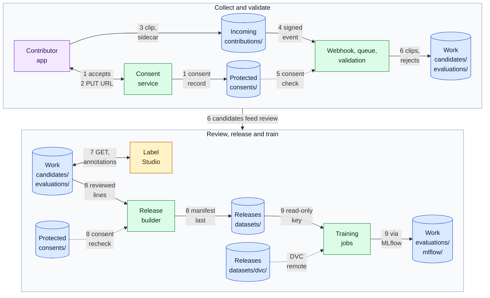

# Voice training data lifecycle

Collect speech recordings with consent, validate and normalize them, review transcripts, and publish versioned, immutable dataset releases that training jobs read with NeMo, Lhotse, Hugging Face Datasets, WebDataset or MosaicML Streaming.

**Validation status:** `source-reviewed-and-automated-tests`. Every third-party behavior on this page comes from the provider's own documentation or source code, read on the dates in [Evidence](#evidence). The ingest, validation, manifest and release steps are implemented by the [`voice-dataset-ingest`](../../applications/voice-dataset-ingest/README.md) application, and its tests run in CI against an emulated S3 server. An opt-in live check of its storage operations (put, get, head, list, presigned PUT, multipart resume, presigned URL expiry and delete) was run against a real B2 test bucket on 2026-10-16; per-object retention and release, bucket configuration, Event Notification delivery and the named tools were not validated live. The release manifest example and its fixture tests also run in CI. See [Known limitations](#known-limitations).

## When to use it

- You collect speech from contributors, customers or vendors and need a record of consent for each clip.
- Several teams or jobs train or evaluate on the same data and need to know exactly which version they used.
- Training runs on GPUs in another location, so the dataset must be readable through an S3-compatible API and cached locally.

## Data flow

Read the top row left to right, then the bottom row. Each arrow starts with the number of the step below that it belongs to; the steps add the keys, schemas and ordering rules. Cylinders are B2 buckets (blue) with their prefixes: the Work and Protected buckets appear in both rows and are the same buckets. Green boxes are components you run, the amber box is a third-party tool, and the purple box is the contributor's client. Dotted arrows are reads that do not move data forward: consent checks and the DVC remote.

1. The contributor accepts the recording and data-use terms. The consent service writes a consent record (schema: [`consent-record.schema.json`](../../schemas/consent-record.schema.json)) to `consents/` in the protected bucket before any upload URL exists.
2. The service signs a presigned PUT URL for one object under `contributions/`, with a short expiry and the expected `Content-Type`. The key that signs it can only write that prefix.
3. The app uploads the clip and a small JSON sidecar with the `consent_id`, the prompt text and the capture settings. Large files use multipart upload with resume ([examples](../../examples/README.md#code-examples)).
4. An Event Notification rule on `contributions/` calls a webhook. The receiver verifies the `X-Bz-Event-Notification-Signature` header, records the `eventId`, answers within the time limit and puts the work on a queue outside B2. Delivery is at least once, so a repeated event is dropped by the `eventId` check.
5. The validation worker takes the job from the queue, reads the clip and sidecar from `contributions/` and the consent record from `consents/`, refuses the clip if consent is missing, withdrawn, expired or does not permit training, and otherwise normalizes the audio (16 kHz, mono, 16-bit PCM in this repository's fixtures), runs the audio checks in [`tools/audio_checks.py`](../../tools/audio_checks.py), redacts personal data from transcripts, and assigns a pseudonymous speaker id.
6. Accepted clips and one NeMo manifest line per clip (schema: [`dataset-line.schema.json`](../../schemas/dataset-line.schema.json)) go to `candidates/` in the work bucket. Rejections and their defect codes go to `evaluations/validation/`.
7. Reviewers correct transcripts and labels in Label Studio. Label Studio reads `candidates/` through presigned GET URLs and writes annotations to `evaluations/review/`.
8. The release builder reads the accepted lines from `candidates/` and the annotations from `evaluations/`, checks the consent record in `consents/` again for every clip and leaves out any clip whose consent is no longer valid, and writes a new release under `datasets/<dataset>/<version>/` in the releases bucket: audio, the NeMo JSONL manifest, Lhotse Shar shards, WebDataset shards, MosaicML Streaming (MDS) shards, `croissant.json`, a README and, last, `release-manifest.json`. A release is never rewritten; any change is a new version.
9. Training jobs read one release with a read-only key that expires, copy or stream shards into a local cache, and log the release id and fingerprint with their results. Metrics, evaluation reports and model artifacts go through the MLflow tracking server, whose own key writes them to `evaluations/mlflow/` in the work bucket; the training key stays read-only. DVC in the training repository uses `datasets/dvc/` in the releases bucket as its remote, separate from the release folders.

## Pipeline stages

### Ingestion with consent

The consent record is the gate for every later step. It names a pseudonymous subject, the permitted uses (`training`, `evaluation`, `analytics`), an expiry, a license and a pointer to the evidence of acceptance. It lives in the protected bucket under Object Lock in governance mode, so it cannot be deleted by mistake, and it is never edited: a withdrawal is a new record version with `status: withdrawn`. The [consent example](../../manifests/consent-record.example.json) shows the fields.

Upload URLs are only issued after the consent record exists. The upload key cannot read, list or delete, so a leaked URL or key cannot expose earlier uploads.

### Normalization and validation

The worker decides each clip once and writes the decision. It checks, at minimum:

- the clip is readable and matches the target sample rate, channel count and bit depth;
- it is not too short, silent, clipped or truncated;
- the declared duration matches the audio header;
- the SHA-256 is recorded and the transcript is not empty;
- the consent record is active, belongs to the same speaker and permits the intended use.

The synthetic fixtures in [`testdata/synthetic-speech/`](../../testdata/synthetic-speech/README.md) include one deliberately invalid clip per defect, and `tests/test_fixtures.py` asserts that each one is detected.

### Dataset manifests and shards

| Format | What it holds | Where in a release | Read by |
|---|---|---|---|
| NeMo JSONL manifest | One JSON line per clip with `audio_filepath`, `duration` and `text`, plus speaker, split, consent id and SHA-256 | `manifests/<split>.jsonl` | NeMo, Lhotse, Hugging Face Datasets (`json` builder) |
| Lhotse Shar | Numbered shards: `cuts.NNNNNN.jsonl.gz` with the cut metadata and `recording.NNNNNN.tar` with the audio, one tar per data type | `shards/lhotse-shar/<split>/` | Lhotse, NeMo with `use_lhotse` |
| WebDataset | Numbered tar shards in which the files of one sample share a basename (for example `utt_0001.wav` and `utt_0001.json`) | `shards/webdataset/<split>-NNNNNN.tar` | WebDataset, Hugging Face Datasets (`webdataset` builder) |
| MosaicML Streaming (MDS) | Shards and an index written by `MDSWriter` | `shards/mds/<split>/` | MosaicML Streaming |

Producing every format is optional. Produce the ones your training code reads, and list each file in the release manifest.

### Review in Label Studio

Label Studio connects to S3-compatible storage through its Amazon S3 storage type, which has an optional S3 endpoint field that overrides the default AWS URL. Use two connections, each with its own B2 application key, because a key admits a single prefix:

- **Source storage** on the work bucket, prefix `candidates/`, with a key that has `listFiles` and `readFiles` only. With "Use pre-signed URLs" on (the default), the reviewer's browser loads audio directly from B2, so the work bucket needs a CORS rule that allows `GET` and `HEAD` from the Label Studio origin ([template](../../examples/cors.s3.json), with the origin changed). With pre-signed URLs off, Label Studio proxies the audio and no CORS rule is needed.
- **Target storage** on the work bucket, prefix `evaluations/review/`, with a key that has `writeFiles` (and `listFiles`). Label Studio exports annotations to target storage when they are submitted or updated. Leave "Can delete objects from storage" off unless the target key also has `deleteFiles` and you want deletions mirrored.

### Releases

A release is complete only when `release-manifest.json` exists, and the builder writes it last. Its schema is [`release-manifest.schema.json`](../../schemas/release-manifest.schema.json); the [example](../../manifests/release-manifest.example.json) describes the synthetic fixtures. Every file is listed with its size and SHA-256, and `integrity.content_fingerprint` is the SHA-256 of the lines `<sha256>  <path>` (the `sha256sum` output format), one per file, sorted by path. `tests/test_release_example.py` recomputes it from the fixture files.

Readers resolve a release by its id (`<dataset>@<version>`), check the fingerprint after download, and never read a release prefix that has no manifest yet.

### MLflow and DVC artifacts

- **MLflow.** Set the tracking server's artifact root to `s3://<work-bucket>/evaluations/mlflow/` and set `MLFLOW_S3_ENDPOINT_URL` to `https://s3.<region>.backblazeb2.com`, which is how MLflow documents S3-compatible artifact stores. Each run logs the release id and fingerprint as parameters, so a metric can always be traced to the exact data.
- **DVC.** In the training repository, `dvc remote add -d b2 s3://<releases-bucket>/datasets/dvc/` and `dvc remote modify b2 endpointurl https://s3.<region>.backblazeb2.com`. DVC stores content-addressed copies under that prefix, and the `.dvc` files in Git pin which data a commit used. Keep the DVC prefix separate from the release folders so that a release stays readable without DVC.

### Reading releases for training

| Reader | How it reaches B2 | Notes |
|---|---|---|
| Lhotse | `CutSet.from_shar(fields=...)` with shard sources as `pipe:` shell commands, for example `pipe:aws s3 cp --endpoint-url https://s3.<region>.backblazeb2.com s3://<releases-bucket>/datasets/<dataset>/<version>/shards/lhotse-shar/train/recording.000000.tar -`, or as `s3://` URIs, which Lhotse opens through `smart_open` | The `pipe:` form passes the endpoint explicitly. The `s3://` form relies on the AWS SDK picking up the endpoint, for example from `AWS_ENDPOINT_URL_S3`, and is not tested here. |
| NeMo | `use_lhotse: true` reads NeMo manifests, tarred NeMo data and Lhotse Shar; NeMo's own object-store support is documented for AIStore (`ais://`) | For B2, read through Lhotse as above, or copy the release to local disk and point `manifest_filepath` at it. |
| WebDataset | Shard URLs with the `pipe:` scheme (for example the same `aws s3 cp ... -` command) or `https://` presigned URLs, which WebDataset reads with `curl` | WebDataset has no built-in `s3://` scheme; it reads `pipe:`, `http(s)://`, `gs://`, `ais://` and `hf://` among others. Presigned URLs must outlive the job's read of that shard. |
| Hugging Face Datasets | `load_dataset("webdataset" or "json", data_files=[...], storage_options=...)`, or `load_from_disk("s3://...", storage_options=...)`, where `storage_options` reaches the `fsspec` backend (`s3fs`) and carries `endpoint_url` | `storage_options` on `load_dataset` is marked experimental in the Datasets reference. |
| MosaicML Streaming | `StreamingDataset(remote="s3://<releases-bucket>/datasets/<dataset>/<version>/shards/mds/train", local="/nvme/cache/...")` with `S3_ENDPOINT_URL=https://s3.<region>.backblazeb2.com` | Streaming's documentation lists Backblaze B2 among S3-compatible stores. Shards download on demand into the local directory. |

Credentials come from the environment (`AWS_ACCESS_KEY_ID` and `AWS_SECRET_ACCESS_KEY` holding a B2 application key ID and key) and are scoped read-only to the releases bucket, prefix `datasets/`, with an expiry.

### Read throughput and B2 Overdrive

Start with standard B2 and a local NVMe or cluster cache: each epoch after the first reads from the cache, and B2 stays the durable source. Run the job at a compute partner when egress to the job's location matters, and model the egress with [`egress_model.py`](../../examples/python/egress_model.py) using the allowance from the [pricing page](https://www.backblaze.com/cloud-storage/pricing). Consider [B2 Overdrive](https://www.backblaze.com/cloud-storage/b2-overdrive) only when sustained aggregate read throughput across many GPUs, measured, is the bottleneck. It is a separate offering with a storage commitment and is not needed for collection, review or releases.

## Boundaries

What B2 is not in this workflow, and what does that job instead.

| Boundary | B2 is not | What does it instead |
|---|---|---|
| Real-time voice transport | B2 does not carry live audio. Contributors record locally and upload finished files. | The capture app or a WebRTC stack, if capture is live. |
| Low-latency conversational session store | B2 holds no live session or per-request state for the contributor app. | The application database or cache. |
| Message queue | Event Notifications start work, but delivery is at least once and the webhook must answer quickly; B2 does not schedule, retry or order jobs. | A queue or job runner outside B2 that the webhook writes to. |
| Transcription or voice generation model | B2 stores audio, transcripts and model artifacts; it does not transcribe, align, redact or generate speech. | ASR, alignment and PII redaction models run by the validation worker. |
| Workflow orchestrator | B2 does not sequence validation, review and release steps. | An orchestrator or the release builder's own job graph. |
| Metadata catalog | Object names and the manifests are not a searchable catalog of speakers, clips and labels. | A metadata database or data catalog that indexes the manifests. |
| Vector database | B2 does not index embeddings for similarity search, deduplication or speaker search. | A vector database; embeddings files can be stored in B2 as release artifacts. |
| Local GPU cache or high-throughput training storage | B2 is the durable source, not the per-step random-read store behind the GPUs. | Local NVMe or a cluster cache filled from a release; B2 Overdrive only when sustained reads are the measured constraint. |

## Where B2 does not fit

- **Per-step random reads during training.** Reading small objects from B2 on every step is slower than reading shards from a local cache. Shard the release and cache it.
- **Searching clips by attribute.** Listing a prefix is not a query. Load the manifests into a database or a data catalog.
- **Consent decisions.** B2 stores the consent records and enforces immutability; the decision to accept, exclude or delete a clip is made by the application.
- **Deleting a withdrawn speaker from trained models.** Storage can remove the clips from future releases and expire old releases; it cannot remove what a model already learned.
- **Very small or one-off datasets.** If a dataset fits on one disk and is read once, a local copy and a single archive object are simpler than this pipeline.

## Object layout

Summary; the full layout, keys and lifecycle are in [`object-layout.md`](object-layout.md).

| Zone | Bucket | Prefixes |
|---|---|---|
| Incoming | `<prefix>-voice-dataset-incoming` | `contributions/` |
| Work | `<prefix>-voice-dataset-work` | `candidates/`, `scratch/`, `evaluations/` |
| Releases | `<prefix>-voice-dataset-releases` | `datasets/` |
| Protected | `<prefix>-voice-dataset-protected` | `consents/` |

One bucket per zone, because lifecycle, Object Lock, replication, encryption defaults and notification rules are set per bucket and an application key admits one prefix. [`provision.py`](../../infrastructure/b2-provisioning/provision.py) prints the commands for exactly these buckets and keys. There is no per-tenant prefix.

## Security

- **Keys.** One application key per component and prefix: the upload signer writes `contributions/` only; the validation worker reads `contributions/` and `consents/` and writes `candidates/` and `evaluations/` through separate keys; Label Studio has a read key and a write key; training jobs get read-only keys on `datasets/` with an expiry. No application key has `deleteFiles`, `bypassGovernance` or `writeKeys` unless its job requires it. See the [scoped key examples](../../examples/README.md#scoped-application-keys).
- **Presigned URLs.** Upload URLs are for one object, one content type and a short expiry. Review URLs are short-lived GETs. A presigned URL is a bearer credential until it expires; do not log it.
- **Webhook.** Verify the HMAC SHA-256 signature on the raw body before parsing, keep the signing secret in a secret manager, and process each `eventId` once ([`notifications.py`](../../examples/python/notifications.py)).
- **Encryption.** SSE-B2 is the default on every bucket ([template](../../examples/encryption.json)). Object names, bucket names and metadata are not encrypted, so they carry pseudonymous ids only, never names, emails or phone numbers.
- **CORS.** Allow only the contributor app's origin on the incoming bucket and only the Label Studio origin on the work bucket.

### Consent and personal data

- Speech is personal data; voice used to identify a person can be biometric data in some jurisdictions. Treat every clip as personal data until consent and purpose are recorded.
- Speaker ids in manifests are pseudonymous. The mapping from pseudonym to person stays in the application's database, not in B2 object names or metadata.
- Transcripts are redacted for names, numbers and addresses before they enter `candidates/`; the unredacted text, if kept, stays in the incoming zone and expires with it.
- A withdrawal adds a new consent record version. The release builder excludes the speaker from every later release, and the affected releases are hidden so that the releases lifecycle rule removes them after its grace period. Releases under compliance-mode Object Lock cannot be removed before retention ends, which is why the releases zone is not locked by default (see [`decisions.md`](decisions.md)).

### Retention

| Data | Retention mechanism |
|---|---|
| Raw contributions and sidecars | Lifecycle on `contributions/`: hidden after the example period, deleted the day after. Set the period from your own policy. |
| Candidates under review | Lifecycle on `candidates/`; a clip not released before then is uploaded again or dropped. |
| Scratch output | Short lifecycle on `scratch/`. |
| Validation reports, annotations, MLflow artifacts | Current versions are kept; superseded versions in `evaluations/` are deleted after the example period. |
| Releases | Current versions kept; hidden versions deleted after a grace period. |
| Consent records | Object Lock governance retention, plus legal hold where required. |

The day counts are in [`examples/lifecycle-*.json`](../../examples/README.md#lifecycle-rules) and are examples, not recommendations. Applying a lifecycle template replaces all of a bucket's lifecycle rules.

### Provenance

Each clip carries its SHA-256 and consent id from validation onwards. Each release lists every file with its hash, the inputs it was built from and the checks it passed, and has a content fingerprint. Training runs log the release id and fingerprint in MLflow, and DVC pins the data a commit used. Together these answer "which consented clips trained this model".

### Access

| Who | Access |
|---|---|
| Contributor app | Presigned PUT for one object in `contributions/` |
| Validation worker | Read `contributions/`, `consents/`; write `candidates/`, `evaluations/` |
| Reviewers | Presigned GET through Label Studio; no B2 key |
| Release builder | Read `candidates/`, `evaluations/`, `consents/`; write `datasets/` |
| Training jobs | Read-only, expiring key on `datasets/` |
| Auditors | Read-only on `consents/`, including retention and legal hold |

## Evidence

All entries were read on the date shown. Product behavior can change; the linked pages are authoritative.

| Date | Source | What it supports |
|---|---|---|
| 2026-10-15 | [NeMo ASR datasets](https://docs.nvidia.com/nemo-framework/user-guide/latest/nemotoolkit/asr/datasets.html) | Manifest fields `audio_filepath`, `duration`, `text`; tarred datasets use WebDataset; `use_lhotse` reads NeMo manifests and Lhotse Shar; object-store support documented for AIStore |
| 2026-10-15 | [Lhotse `CutSet.from_shar` source](https://github.com/lhotse-speech/lhotse/blob/master/lhotse/cut/set.py), [Lhotse `open_best` source](https://github.com/lhotse-speech/lhotse/blob/master/lhotse/serialization.py) | Shar layout (`cuts.NNNNNN.jsonl.gz`, `recording.NNNNNN.tar`), `fields` with `pipe:` commands, `s3://` URIs through `smart_open` |
| 2026-10-15 | [WebDataset README](https://github.com/webdataset/webdataset), [WebDataset URL schemes](https://github.com/webdataset/webdataset/blob/main/src/webdataset/gopen.py) | Samples share a basename in a tar; reading through `pipe:` and `curl`; no built-in `s3://` scheme; `ShardWriter` |
| 2026-10-15 | [Hugging Face Datasets loading methods](https://huggingface.co/docs/datasets/package_reference/loading_methods), [Load](https://huggingface.co/docs/datasets/loading), [s3fs](https://s3fs.readthedocs.io/en/latest/) | `storage_options` (experimental on `load_dataset`), `load_from_disk` from `s3://`, `webdataset` builder with streaming, `endpoint_url` for S3-compatible services |
| 2026-10-15 | [MosaicML Streaming cloud credentials](https://docs.mosaicml.com/projects/streaming/en/stable/how_to_guides/configure_cloud_storage_credentials.html), [main concepts](https://docs.mosaicml.com/projects/streaming/en/stable/getting_started/main_concepts.html) | `S3_ENDPOINT_URL`, Backblaze B2 listed as S3-compatible, `MDSWriter`, `remote` and `local` with on-demand shard download |
| 2026-10-15 | [Label Studio Amazon S3 storage](https://labelstud.io/guide/storage_s3) | Optional S3 endpoint field, CORS with `GET` only when pre-signed URLs are used, target storage exports annotations, permissions per connection |
| 2026-10-15 | [MLflow artifact stores](https://mlflow.org/docs/latest/self-hosting/architecture/artifact-store/) | `MLFLOW_S3_ENDPOINT_URL` for S3-compatible artifact stores |
| 2026-10-15 | [DVC Amazon S3 remotes](https://doc.dvc.org/user-guide/data-management/remote-storage/amazon-s3) | `dvc remote modify <name> endpointurl <url>` for S3-compatible storage |
| 2026-10-15 | [AWS SDK service-specific endpoints](https://docs.aws.amazon.com/sdkref/latest/guide/feature-ss-endpoints.html), [AWS CLI with B2](https://www.backblaze.com/docs/cloud-storage-use-the-aws-cli-with-backblaze-b2) | `AWS_ENDPOINT_URL_S3` and `--endpoint-url` |
| 2026-10-15 | [B2 Overdrive](https://www.backblaze.com/cloud-storage/b2-overdrive) | Separate high-throughput offering for sustained reads, enabled by Backblaze under a storage commitment |
| 2026-10-15 | [B2 capability map](../../docs/b2-capabilities.md) and the Backblaze pages it links | Event Notifications, application keys, lifecycle rules, Object Lock, encryption, CORS, replication |
| 2026-10-15 | [B2 application keys](https://www.backblaze.com/docs/cloud-storage-application-keys) | Capability names for retention: `readFileRetentions`, `writeFileRetentions`, `readBucketRetentions`, `writeBucketRetentions`, `bypassGovernance` |
| 2026-10-15 | [`applications/voice-dataset-ingest/tests/`](../../applications/voice-dataset-ingest/tests) | Consent gate, signed and repeated events, validation, manifest order and per-object retention behave as described, against an emulated S3 server |
| 2026-10-16 | [`applications/voice-dataset-ingest/tests/test_live.py`](../../applications/voice-dataset-ingest/tests/test_live.py) | Run once against a real B2 test bucket, writing only under a unique `live-test/<uuid>/` prefix and deleting what it wrote: authentication and the endpoint derived from the region, put, get, head, list, presigned PUT through the real endpoint, a multipart upload interrupted after its first part and resumed with only the second part uploaded (size and SHA-256 matched), expiry of a presigned URL (B2 answered HTTP 401 on that date; observed behavior, not a documented guarantee) and delete. The Object Lock configuration read was skipped because the key used could not read it |

## Known limitations

- Per-tenant isolation is not covered. The layout assumes a single organization; separate tenants need their own buckets and keys.
- Live validation covers storage operations only (see Evidence). Not validated live: per-object retention and release (the Object Lock configuration of the test bucket could not be read with the key used, and a release creates objects that cannot be deleted until their retention ends, so it is not run on a shared bucket); bucket configuration (lifecycle, CORS, Event Notification, replication and encryption templates are checked for shape only); Event Notification delivery; and Label Studio, MLflow, DVC and the dataset libraries. The configuration shown is taken from each tool's documentation. The application's CI tests run against an emulated S3 server.
- The [`voice-dataset-ingest`](../../applications/voice-dataset-ingest/README.md) application covers consent-gated upload, signed events, validation, normalization, the NeMo manifest and a release with per-object Object Lock retention, in a single bucket with zone prefixes. It has no consent service, no review step, no Lhotse, WebDataset or MDS shard builder and no HTTP receiver; the repository also provides the schemas, the release manifest example, the fixtures and the audio checks.
- Removing a withdrawn speaker from models already trained is outside storage and is not covered.
- PII redaction of transcripts is named as a step; no redaction model or rule set is provided.
